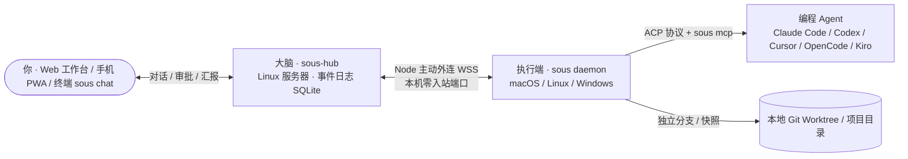

# sous

**你的副主厨：一个长期运行、随叫随到的私人 AI 助理与多编程 Agent 调度中枢。**

你是主厨，只管和它讨论需求、在关键节点拍板；`sous` 自己维护项目与任务、按预设调度你多台电脑和服务器上的 **Claude Code / Codex / Cursor / OpenCode / Kiro** 等编程 agent 并发干活，需要时找你审批，完成后带着结构化验证结果向你汇报，并在手机、电脑、网页与终端上随时可用。

> *sous* 取自法餐后厨的 *sous-chef*（副主厨）：你是主厨，它替你指挥各个岗位。

---

## 结构与工作流示意



```text
01 讨论需求          02 拆解与派发            03 Agent 隔离执行         04 分层审批               05 验收与按需交付
project_read /      task_create 选预设、     Node 启动 ACP 会话，      本地底线拦截 → 审批 Agent   解析「## 结果」叫醒主管，
machine_look /  ──► 机器与执行位置       ──► 通过 sous mcp 实时   ──► 过滤常规操作 → 工作台  ──► 按你的指令执行 commit /
只读项目顾问 consult (worktree/就地/临时)     报进度、向主管提问        卡片一键「允许 / 拒绝」     merge / push / 开 PR
```

---

## 核心能力

1. **Hub 只动脑，Node 才动手**：`sous-hub` 常驻 Linux 服务器，负责模型调用、单一事件日志（`eventlog.Log`）、长对话分段摘要与通知，**绝不执行 shell 命令、不直接读写代码仓库**；`sous` 客户端运行在你的开发机与服务器上，主动连接 Hub（无需公网 IP 或入站端口），并在本地二次强制校验权限模式与底线规则。
2. **统一调度多家编程 Agent（ACP）**：通过标准 Agent Client Protocol 驱动本机已安装并登录的 **Claude Code**、**Codex**、**Cursor**、**OpenCode**、**Kiro**，并支持在 `~/.sous/node.json` 的 `custom_agents` 中接入任意自定义 ACP agent。常用的「agent + 模型 + 思考强度」可保存为**预设**，由主管按在线电脑自动匹配。
3. **独立 Worktree 与就地快照隔离**：代码任务可在 `~/.sous/worktrees/<仓库名>/<id>/` 的独立分支（`sous/<标题>-<id>`）中执行，不触碰原工作区；就地任务（`in_place`）自动拍快照并支持一键恢复。任务做完后改动停在分支上，只有你明确发话才执行 `git_commit`、`git_merge`（仅快进）、`git_push` 或 `git_pr`，绝不擅自合并主分支。
4. **分层自动审批与本地安全底线**：Node 本地底线正则当场拒绝删主目录、格式化磁盘等高危命令；确定性规则识别凭据、外传、改远端、提权、受保护分支等硬信号一律交你审批；常规操作由审批 agent 判断或按 `auto` 模式放行，需要人工拍板的请求直接内嵌在工作台任务卡片上（「允许这一次 / 拒绝」）。
5. **主管闭环与跨端随叫随到**：子 agent 通过本地 `sous mcp` 实时报进度（`report_progress`）、遇到分歧向主管或你提问（`ask_supervisor`）、结束时提交结构化结果（`report_result`），事件自动叫醒主管继续推进。支持桌面三栏工作台、iOS Liquid Glass 手机主屏 PWA 与本机终端 `sous chat`，断网期间事件持久化在本地 `outbox.jsonl`，重连后自动对账补发。

---

## 安装与快速开始

### 1. 安装 `sous` 客户端（开发机 / 服务器）

一键安装脚本会从 [GitHub Releases](https://github.com/XiaoXianThis/Sous/releases) 下载对应平台二进制、校验 `checksums.txt` 并安装至 `~/.local/bin`（已安装则原地更新并重启服务）：

**macOS / Linux：**

```sh
curl -fsSL https://raw.githubusercontent.com/XiaoXianThis/Sous/main/work/scripts/install-sous.sh | sh
```

**Windows PowerShell：**

```powershell
irm https://raw.githubusercontent.com/XiaoXianThis/Sous/main/work/scripts/install-sous.ps1 | iex
```

### 2. 配对机器并启动常驻服务

在已部署的 Hub 网页端打开 **机器 → 配对新机器** 获取 10 分钟内有效的配对命令，在本机执行：

```sh
# 配对开发机并指定项目工作空间目录（服务器接入可追加 --role server）
sous pair https://agent.wxian.cc 123456 --name 我的笔记本 --workspace ~/Code

# 检查本机已安装且已登录的编程 agent
sous agents

# 注册后台常驻服务并启动（macOS LaunchAgent / Linux systemd 用户服务）
sous service install
sous service start
sous status

# 随时在终端直接与 sous 对话和审批
sous chat
```

### 3. 从源码构建与部署 Hub

本仓库遵循 [`wokspace`](https://wokspace.wxian.cc) 规范，包含 `apps/core`（Go 核心）、`apps/web`（React PWA）、`apps/desktop`（Wails 桌面壳）和 `apps/site`（Astro 官网与文档站）：

```sh
git clone https://github.com/XiaoXianThis/Sous.git
cd Sous

wok ls                        # 查看所有应用及其任务
wok build web                 # 构建 PWA 前端 -> build/web/
wok build core                # 构建本机 sous 与 sous-hub -> build/core/
wok run core build-hub-linux  # 交叉编译 Linux 服务端 -> build/core/linux-amd64/sous-hub
wok build site                # 构建官网与文档站 -> build/site/
```

服务端 `sous-hub` 的完整生产部署步骤（`systemd` + `Caddy` HTTPS + Passkey 注册 + 每日备份）请参见 [部署 Hub](docs/guides/deploy-hub.md)。

---

## 文档链接

- **文档总入口**：[docs/README.md](docs/README.md)
- **使用与运维指南**：[部署 Hub](docs/guides/deploy-hub.md) · [接入一台电脑或服务器](docs/guides/connect-machine.md) · [macOS 签名与隐私权限](docs/guides/macos-signing-and-permissions.md)
- **系统架构**：[工作台：项目、预设、任务和机器](docs/architecture/workbench.md) · [主管的上下文与分段摘要](docs/architecture/supervisor-context.md)
- **架构决策记录（ADR）**：[decisions/README.md（0001–0026）](docs/decisions/README.md)
- **应用间接口契约**：[api/README.md](docs/api/README.md)（[core-hub-http](docs/api/core-hub-http.md) · [core-hub-node](docs/api/core-hub-node.md) · [core-daemon-ipc](docs/api/core-daemon-ipc.md)）
- **仓库与代理规范**：[AGENTS.md](AGENTS.md) · [apps/README.md](apps/README.md)

---

## License

Released under the [MIT License](LICENSE).
