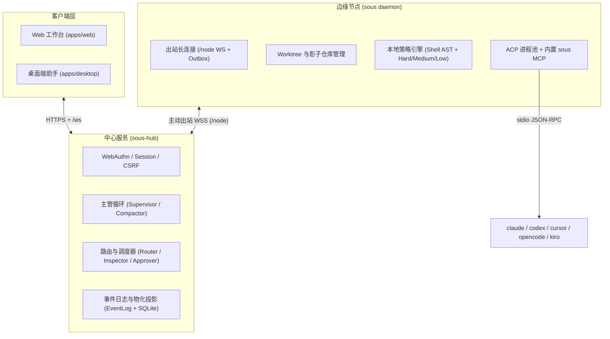
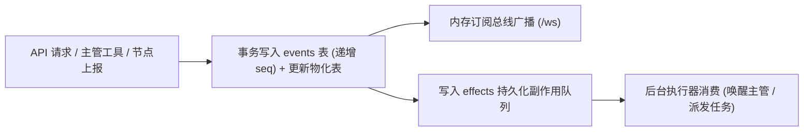

## 为什么采用这套架构

个人或多机 AI 开发工具最常见的痛点是：**关掉电脑或切到手机就失联**、**多个 Agent 同时改一个目录互相覆盖**、以及**把宿主机暴露给公网带来严重安全隐患**。

Sous 通过「中心 Hub 常驻 + 边缘 Daemon 主动外连 + 按任务 Worktree 隔离 + 事件溯源单库存储」四项核心设计解决这些问题。本页基于 `docs/architecture/`、`docs/decisions/` 与 `apps/core` 实现代码，完整拆解系统内部运作机制。

---

## 1. Hub 与 Daemon 分离

Sous 在逻辑上分为中心端（`sous-hub`）与节点端（`sous daemon`），两者编译自同一个 Go 模块（`apps/core`），零 CGO 依赖。

### 职责边界

- **`sous-hub`（中心大脑）**：
  - 托管 Web 静态资源，处理 Passkey 登录、会话管理与实时 `/ws` 广播。
  - 运行主管（`supervisor`）多步工具循环、长对话分段压缩（`compactor`）、机器路由（`router`）、巡检（`inspector`）与 AI 审批员（`approver`）。
  - 维护唯一真相源（SQLite `hub.db`），不直接接触业务代码仓库，也不执行任意业务 Shell。
- **`sous daemon`（边缘手脚）**：
  - 运行在开发者的 Mac / Linux / Windows 电脑或被管服务器上，**只主动向 Hub 发起出站连接**，本机不监听任何公网端口。
  - 负责扫描本地工作区 Git 仓库、准备任务隔离目录（Worktree / 影子仓库）、执行本地策略分类（`internal/policy`）、通过 ACP 协议驱动本地编码 Agent，并采集变更差异（Diff）与脚本取证数据。

---

## 2. 连接与多域鉴权

Sous 没有引入复杂的外部账号体系，而是针对单人/小团队自托管场景设计了三套相互独立的鉴权域（详见 `docs/architecture/security.md`）：

### 浏览器到 Hub：WebAuthn Passkey + Fresh 窗口

1. **Passkey 注册与登录**：首次访问未绑定凭证的 Hub 时，直接引导创建第一把 Passkey（Touch ID / Face ID / Windows Hello / YubiKey）。登录成功后下发 `HttpOnly; SameSite=Lax` 的 `sous_session` Cookie（默认有效期 `720h`），并在数据库中仅保存会话 Token 的 SHA-256 哈希。
2. **双重提交 CSRF 防护**：下发会话的同时设置可读 Cookie `sous_csrf`，所有写接口（`POST`/`PUT`/`PATCH`/`DELETE`）必须携带匹配的 `X-Sous-CSRF` 请求头。
3. **15 分钟敏感操作复验（`requireFresh`）**：对于生成节点配对码、修改模型 API Key、远程更新节点配置、删除节点、触发升级以及打开网页终端（`/api/v1/terminal`）等高危操作，Hub 要求当前会话的 `fresh_until` 处于最近 15 分钟内；超时则触发浏览器弹窗进行一次无感生物识别复验。

### 节点到 Hub：一次性配对码 + 独立 Node Token

1. 网页端在 `requireFresh` 保护下生成 6 位数字配对码（10 分钟有效，存放在 `pair_codes` 表，单次消费即焚）。
2. 节点执行 `sous pair <hub-url> <6-digit>`，换取专属的随机 `node_token` 并写入本机 `~/.sous/node.json`（文件权限强制 `0600`）。
3. Hub 在 `node_tokens` 表中只存储该 Token 的 SHA-256 哈希。节点通过 `Authorization: Bearer <token>` 连接 `/node` WebSocket；一旦在网页解绑该节点，Token 立即失效。

### 本机 CLI 到 Daemon：Unix Socket / 命名管道

- 在 macOS 与 Linux 上，`sous status` 等本地命令通过 `~/.sous/daemon.sock`（所在目录权限 `0700`）与本机守护进程通信。
- 在 Windows 上，使用当前登录用户 SID 限定的 Named Pipe，防止同机其他低权限账户越权访问。

---

## 3. 事件溯源与状态投影

Hub 的核心状态流转建立在 `apps/core/internal/eventlog` 与 `internal/store` 之上（详见 ADR 0003）：

1. **同事务双写（Event + Projection）**：每当发生业务变更（如创建任务 `task.created`、审批裁决 `approval.resolved`），Hub 在同一个 SQLite 事务中：
   - 向追加写（Append-only）的 `events` 表插入一条带自增序号 `seq` 的事件记录；
   - 同步更新对应的物化查询表（如 `tasks`、`runs`、`approvals`）。
2. **断线无损追赶（`/ws?since=<seq>`）**：浏览器打开页面时先调用 `GET /api/v1/state` 获取当前最新物化快照与最大 `seq`；随后连接 `/ws?since=<seq>`。就算手机切后台或网络闪断，重连时只需传入最后收到的 `seq`，Hub 即可从 `events` 表精确补发期间漏掉的所有持久化事件。
3. **临时流式事件（`seq: 0`）**：像主管打字流（`message.assistant.delta`）、子 Agent 实时终端输出（`run.output`）这类高频分片，通过 `event.Ephemeral()` 标记为 `seq: 0`，直接经内存总线广播给在线客户端，避免撑爆 SQLite 磁盘。
4. **节点端断线重传（`outbox.jsonl`）**：节点守护进程在向 Hub 发送关键状态帧（如 `run.done`、`approval.request`）时，若遇网络中断，会先写入本地 `~/.sous/outbox.jsonl`，待指数退避重连成功后再按序重放，保证任务结果绝不因断网丢失。
5. **只增提示词尾部（`prompts.Tail`）**：主管上下文采用前缀固定、尾部只增的构造方式（ADR 0023），将动态变化的任务与机器状态放在消息尾部，最大化命中 Anthropic / OpenAI 的 Prompt Caching，大幅降低 Token 成本与首字延迟。

---

## 4. 任务调度与并发控制

当主管创建任务并进入 `queued` 状态后，调度器（`apps/core/internal/router` 与 `internal/task`）按以下规则将其派发为具体的 `Run`：

### 机器选择（Router）

1. **显式指定优先**：若任务指定了目标 `node_id`，直接派往该节点。
2. **项目工作区亲和性**：若任务关联了项目（`project_id`）或 `repo_hint`，优先选择已经克隆了该仓库且在线的节点。
3. **角色偏好与负载回退（ADR 0025）**：代码开发任务优先选择 `role: "dev"` 的机器，部署运维任务优先选择 `role: "server"` 的机器；若有多个候选节点，由轻量级 `router` 模型或空闲槽位策略挑选。当首选角色的机器均不满足条件时，会回退到其他在线机器并在任务备注中写入明确提示（`【任务派到了别的机器】`）。

### 并发槽位与互斥规则

- **单机并发上限（`max_concurrent_runs`）**：每台机器在 `node.json` 中定义了最多同时运行的 Run 数量（默认 `2`）。超出上限的任务保持在 `queued` 队列中，一旦有 Run 结束立即自动补位。
- **`worktree` 并发无锁**：使用 `location: "worktree"` 的多个任务即使针对同一个 Git 仓库，也会各自检出独立的分支与工作目录，可以在同一台机器上并行运行。
- **`in_place` 仓库级互斥**：使用 `location: "in_place"` 的任务直接修改主工作区。为防止写冲突，调度器对同一节点上的同一仓库实施互斥锁——前一个 `in_place` 任务结束前，后一个同仓库 `in_place` 任务排队等待。
- **跨任务文件冲突预警（Overlap Detection）**：当同一仓库的多个并行 `worktree` 任务完成时，系统会比对各自的变更文件列表（Changed Files），若发现修改了相同文件，会在工作台提示合并冲突风险。
- **后台巡检（Inspector）**：每隔固定周期，Hub 检查长时间无事件输出的活跃 Run，调用 `inspector` 角色判断子 Agent 是否陷入死循环或等待未知输入；若确认为卡死（`stuck`），自动暂停该 Run 并通知主管处理。

---

## 5. Worktree 与影子仓库隔离

Sous 根据任务的 `location` 属性提供三种执行环境（实现在 `apps/core/internal/worktree/`）：

### 1. `worktree`（默认，Git 仓库隔离）

- 节点在 `~/.sous/worktrees/<project>/<task-id>/` 下调用 `git worktree add -b sous/<slug>-<shortid>` 创建独立工作树。
- 子 Agent 的 `cwd` 与 `allowed_roots` 被限制在该 Worktree 目录中，主代码目录的当前分支与未提交修改完全不受影响。
- **生命周期（ADR 0022）**：Run 完成后，代码保留在 `sous/<slug>-<shortid>` 分支上，Worktree 目录继续保留供你预览 Diff 或返工；直到你在工作台执行「合并（Merge）」「提交 PR」「丢弃（Discard）」或取消任务后，Worktree 才会被自动清理。

### 2. `in_place`（原地工作区 + 影子仓库快照）

- 当任务需要在用户当前目录直接执行，或者目标目录**还不是 Git 仓库**时，节点会在 `~/.sous/shadows/<task-id>/` 下初始化一个隐藏的裸 Git 仓库（Shadow Repo）。
- 在 Run 启动前与结束后，节点利用该影子仓库对目标目录拍摄字节级精确快照（在 Windows 上同样保持 CRLF 原始字节一致，不污染用户目录），从而即使在非 Git 目录中也能支持完整的**变更 Diff 查看**与**一键回滚（Discard）**。

### 3. `scratch`（临时草稿目录）

- 节点在 `~/.sous/scratch/<task-id>/` 下创建空白临时目录，适合一次性调研、写独立脚本或处理附件，不关联任何现有仓库。

---

## 6. 存储设计（SQLite 表结构概览）

`sous-hub` 使用纯 Go 实现的 `modernc.org/sqlite` 驱动，开启 **WAL（Write-Ahead Logging）** 模式、`busy_timeout=5000` 与外键约束。全部 schema 迁移位于 `apps/core/internal/store/migrate.go`（共 22 张表），按领域划分如下：

### 事件、副作用与键值设置

| 表名 | 核心字段 | 用途 |
|---|---|---|
| `schema_migrations` | `version`, `applied_at` | 记录已执行的数据库迁移版本 |
| `events` | `seq` (PK), `type`, `ts`, `data_json` | 全局只增事件日志，支撑 `/ws?since=<seq>` 断线补发 |
| `effects` | `id`, `kind`, `payload_json`, `status`, `run_after` | 持久化异步副作用队列（如合批唤醒主管、触发任务派发） |
| `settings` | `key` (PK), `value_json`, `updated_at` | 全局键值配置（如 `approval_policy`、模型角色覆盖等） |

### 对话、分段摘要与附件

| 表名 | 核心字段 | 用途 |
|---|---|---|
| `messages` | `id`, `seq`, `role`, `content`, `attachments_json`, `tools_json`, `segment_id` | 主管与用户的聊天消息及主管调用的工具摘要 |
| `conversation_segments` | `id`, `start_seq`, `end_seq`, `summary`, `decisions_json`, `created_at` | 长对话压缩后的结构化历史摘要段（供 `recall_history` 检索） |
| `attachments` | `id`, `name`, `mime`, `size`, `disk_path`, `created_at` | 用户上传的图片与文件附件元数据 |

### 任务、Run、审批与策略记忆

| 表名 | 核心字段 | 用途 |
|---|---|---|
| `tasks` | `id`, `title`, `prompt`, `status`, `node_id`, `project_id`, `preset`, `location`, `acceptance`, `branch`, `git_state`, `progress_text`, `result_json` | 任务主表（物化最新状态、分支状态与结构化结果） |
| `runs` | `id`, `task_id`, `node_id`, `agent`, `model`, `effort`, `status`, `error_kind`, `session_id`, `worktree_path`, `started_at`, `finished_at` | 任务每次具体执行（Run）的元数据与 ACP `session_id` |
| `run_events` | `id`, `run_id`, `seq`, `kind`, `payload_json`, `ts` | 子 Agent 执行过程中的工具调用与输出记录 |
| `approvals` | `id`, `task_id`, `run_id`, `node_id`, `kind`, `level`, `title`, `command`, `cwd`, `status`, `decision`, `decided_by`, `evidence_json` | 待审批与已裁决的权限请求记录 |
| `approval_rules` | `id`, `node_id`, `project_id`, `kind`, `pattern`, `exec_identity`, `created_at` | 用户点击「以后这类都行（`allow_always`）」生成的持久化白名单规则（绑定脚本 SHA-256 身份） |

### 节点、配对与鉴权安全

| 表名 | 核心字段 | 用途 |
|---|---|---|
| `nodes` | `id`, `name`, `role`, `online`, `version`, `roots_json`, `agents_json`, `repos_json`, `config_json`, `last_seen_at` | 已接入的电脑与服务器状态及扫描到的仓库快照 |
| `node_tokens` | `node_id` (PK), `token_hash`, `created_at` | 节点 WebSocket 鉴权 Token 的 SHA-256 哈希 |
| `pair_codes` | `code_hash` (PK), `expires_at`, `used_at` | 一次性 6 位节点配对码哈希 |
| `device_codes` | `code_hash` (PK), `device_name`, `token_hash`, `expires_at`, `approved_at` | 桌面端（`apps/desktop`）设备配对凭证 |
| `webauthn_credentials` | `id` (PK), `public_key`, `sign_count`, `name`, `created_at`, `last_used_at` | 已注册的 Passkey 公钥凭证 |
| `auth_sessions` | `token_hash` (PK), `csrf_token`, `expires_at`, `fresh_until`, `user_agent` | 浏览器登录会话与 15 分钟 `fresh` 复验时间戳 |

### 项目、预设、MCP 与定时调度

| 表名 | 核心字段 | 用途 |
|---|---|---|
| `projects` | `id`, `name`, `repo_url`, `default_branch`, `deploy_json`, `preview_json` | 项目定义、Git 远端地址、部署配置与预览配置 |
| `role_presets` | `name` (PK), `label`, `description`, `agent`, `model`, `effort`, `prompt`, `builtin` | 内置与用户自定义的子 Agent 预设（岗位） |
| `mcp_servers` | `name` (PK), `command`, `args_json`, `env_json`, `url`, `enabled` | 主管可调用的外部 MCP Server 注册表 |
| `schedules` | `id`, `name`, `cron_expr`, `prompt`, `project_id`, `preset`, `enabled`, `last_run_at`, `next_run_at` | Cron 定时任务配置与执行计划 |

---

## 下一步

- 查看常见故障的排查方法：[常见问题与排错（FAQ）](/docs/faq-troubleshooting)
- 返回查阅接口与配置详情：[CLI 与配置文件参考](/docs/cli-and-config)
