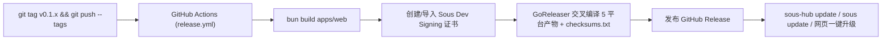

## 为什么阅读本页

如果你想从源码编译 `sous` 与 `sous-hub`、修改前端工作台、接入新的编码 Agent，或者了解 Sous 如何通过 GitHub Actions 发布版本并处理 macOS 本地权限弹窗，本页提供了完整的工程说明。

---

## 仓库结构（Wokspace 规范）

Sous 遵循 [Wokspace](https://wokspace.wxian.cc) 多应用工作区规范（详见仓库根目录 `AGENTS.md`）。根目录不是单一语言的工程，而是由四个冻结的骨架目录组成：

```text
Sous/
├── AGENTS.md              # 工作区最高工程规范（目录冻结、命名与跨平台约束）
├── apps/                  # 独立子项目（互不直接引用源码）
│   ├── core/              # Go 后端与 CLI（产出 sous-hub 与 sous 两个二进制）
│   ├── web/               # React 19 + Vite 6 + Tailwind v4 单页工作台
│   ├── desktop/           # Wails v2 + React 19 桌面端状态栏与配对助手
│   └── site/              # Astro 5 + Tailwind v4 官方文档与门户站点
├── build/                 # 最终构建产物目录（如 build/core/、build/web/、build/site/）
├── docs/                  # 长期有效的事实文档（只记录当前真相与原因）
│   ├── architecture/      # 系统架构与安全设计
│   ├── decisions/         # 架构决策记录（ADR 0001–0028）
│   ├── guides/            # 部署与机器接入指南
│   └── api/               # 应用间通信契约（HTTP / WebSocket / Daemon IPC）
└── work/                  # 研发过程材料
    ├── specs/             # 需求规格、设计与实施记录（sous-mvp、m5-workbench、approval-friction 等）
    ├── scripts/           # 可复用工具脚本
    ├── tests/             # 跨应用集成与端到端测试
    └── tmp/               # 临时实验目录（任务结束即清理）
```

### 应用间依赖规则

- `apps/<name>/` 之间**绝不直接通过相对路径引用彼此源码**。
- 允许的协作方式只有两种：
  1. 消费另一个应用在 `build/<app>/` 下的构建产物（例如 `sous-hub` 通过 `-config` 中的 `web_dir: "../../build/web"` 托管 `apps/web` 的静态产物）。
  2. 通过 `docs/api/` 中的契约通过 HTTP / WebSocket / Unix Socket 通信。

---

## 构建与测试命令

每个应用在自己的 `apps/<name>/AGENTS.md` 中都定义了标准的任务表（`install`、`dev`、`test`、`build`）。你可以使用 `wok` CLI 在仓库任意位置运行，也可以进入对应目录直接执行原生工具链命令。

### 使用 `wok` 统一执行

```bash
# 查看所有应用及其任务定义
wok ls

# 安装所有应用依赖
wok install --all

# 构建指定应用（产物输出到 build/<app>/）
wok build core web site

# 运行全部单元测试与构建检查
wok test --all

# 检查工作区目录结构、命名规范与冻结根约束
wok check
```

### 各应用原生命令对照

| 应用 | 目录 | 安装依赖 (`install`) | 本地开发 (`dev`) | 测试 (`test`) | 构建 (`build`) |
|---|---|---|---|---|---|
| **core** | `apps/core` | `go mod download` | `go run ./cmd/sous-hub -config configs/hub.example.yaml` | `go test ./...` | `go build -o ../../build/core/sous-hub ./cmd/sous-hub && go build -o ../../build/core/sous ./cmd/sous` |
| **web** | `apps/web` | `bun install` | `bun run dev` | `bun run test` | `bun run build --outDir ../../build/web` |
| **desktop** | `apps/desktop` | `cd frontend && bun install` | `wails dev` | `go test ./... && cd frontend && bun run build` | `wails build -clean -o sous-desktop` |
| **site** | `apps/site` | `bun install` | `bun run dev` | `bun run test` | `bun run build --outDir ../../build/site` |

---

## 如何新增一个编码 Agent

在 Sous 中新增一个编码 Agent 有两种方式：**配置级扩展（无需改代码）**与**源码级内建**。

### 方式一：通过 `custom_agents` 配置（推荐先行验证）

只要目标 CLI 支持 **ACP（Agent Client Protocol，JSON-RPC 2.0 over stdio）**，无需修改 `apps/core` 源码，直接在节点的 `~/.sous/node.json` 中添加 `custom_agents` 即可：

```json
{
  "custom_agents": [
    {
      "name": "my-agent",
      "title": "My Custom Agent",
      "command": ["my-agent-cli", "acp"]
    }
  ]
}
```

添加后运行 `sous agents` 或在网页点「重新检测」，该 Agent 就会出现在节点可用列表与预设选择器中。

### 方式二：在 `apps/core` 中新增内建 Agent

如果要把一个通用 Agent 加入 Sous 默认自动探测名单：

1. 编辑 `apps/core/internal/agents/agents.go` 中的 `Builtin()` 切片，填入 `Spec`：
   - `Name`：内部唯一标识符（小写，如 `"kiro"`）。
   - `Title`：界面展示名称（如 `"Kiro"`）。
   - `Binary`：在 `PATH` 中探测的二进制名（如 `"kiro-cli"` 或 `"cursor-agent"`）。
   - `Launch`：启动 ACP 会话的命令切片（如原生支持 `acp` 子命令则 `[]string{"kiro-cli", "acp"}`，若需桥接包则 `[]string{"npx", "-y", "..."}`）。
   - `Install` / `Upgrade` / `Login` / `Logout`：可选的远程管理配方（`Recipe`）。
2. 如该 Agent 在无 TTY 环境下需要特定的保活或参数适配，在 `apps/core/internal/acp/` 中补充对应测试。
3. 在 `apps/web` 的 Agent 图标映射中补充品牌图标，并在 `apps/core` 运行 `go test ./internal/agents/...`。

---

## 如何新增一个 App

当需要向仓库添加新的独立端或服务时（需先与维护者确认名称）：

1. 使用 kebab-case 名称执行 `wok new <name>`（若未安装 `wok`，则参照 `apps/README.md` 模板创建 `apps/<name>/AGENTS.md`，并将应用登记到 `apps/README.md` 的列表中）。
2. 进入 `apps/<name>/` 使用对应语言的脚手架初始化工程。
3. 在 `apps/<name>/AGENTS.md` 中填写任务表（`install`、`dev`、`test`、`build`），确保 `build` 将最终产物输出到 `"$WOK_OUT"`（即 `build/<name>/`）。
4. 运行 `wok ls <name>` 与 `wok check` 验证配置合规。

---

## 发布流程（Tag → Release → 机器自升级）

Sous 的版本发布通过 GitHub Actions 与 GoReleaser 自动化完成（配置位于 `.github/workflows/release.yml` 与 `apps/core/.goreleaser.yaml`）。



### 发布步骤

1. 确保主分支测试全部通过：`cd apps/core && go test ./...` 与 `cd apps/web && bun run test`。
2. 打上语义化版本标签并推送：
   ```bash
   git tag v0.1.8
   git push origin v0.1.8
   ```
3. GitHub Actions（运行在 `macos-latest` 以支持调用 macOS 原生 `codesign`）会自动：
   - 构建 `apps/web` 前端静态资源并注入 `apps/core`。
   - 将 `-X main.version={{.Version}}` 注入 `sous` 与 `sous-hub`。
   - 编译 `linux/amd64`、`linux/arm64`、`darwin/amd64`、`darwin/arm64`、`windows/amd64` 五个平台的归档包与裸二进制，并对 `darwin` 二进制执行代码签名。
   - 生成 `checksums.txt` 并发布到 GitHub Releases。
4. **机器更新**：
   - **网页一键更新**：在网页「设置 → 更新」检查最新版本，可一键触发在线节点（`POST /api/v1/nodes/{id}/update`）下载新二进制并自动重启服务。
   - **命令行更新客户端**：在节点电脑上执行 `sous update`（可通过 `--check` 仅检查，或 `--version v0.1.7` 指定版本）。更新器会校验 `checksums.txt` 的 SHA-256 签名后再原子替换二进制并通知守护进程重启。
   - **服务端 Hub 更新**：在服务器上拉取最新 Release 归档或运行 `wok run core build-hub-linux` 替换 `/usr/local/bin/sous-hub` 后执行 `sudo systemctl restart sous-hub`。

---

## macOS 代码签名与 TCC 权限问题

### 为什么未签名或 Ad-hoc 签名会导致弹窗与卡死

在 macOS 上，`sous daemon` 由 `~/Library/LaunchAgents/cc.wxian.sous.plist` 在后台无界面启动。当子 Agent 访问受 macOS **TCC（Transparency, Consent, and Control）** 保护的目录（如 `~/Desktop`、`~/Documents`、`~/Downloads`）时：

- 如果每次编译或升级后的 `sous` 二进制使用的是随机 Ad-hoc 签名（`codesign -s -`），macOS 会根据变化的 CDHash 判定这是一个「全新的未知程序」，从而反复弹出权限请求窗口，或者在无 GUI 会话下直接挂起 I/O 导致 Run 卡死。
- 为解决此问题（详见 ADR 0028），Sous 使用固定名称的自签名代码签名证书 **`Sous Dev Signing`**，并在签名时绑定固定的标识符 `--identifier cc.wxian.sous`。这样无论二进制升级多少次，macOS TCC 都将其识别为同一个受信任主体。

### 本地开发签名配置

在 macOS 上首次进行本地编译前，运行一次证书初始化任务：

```bash
# 自动在登录钥匙串创建并信任 "Sous Dev Signing" 证书
wok run core setup-signing
```

此后执行 `wok build core`（或运行 `bash apps/core/scripts/build.sh`）时，构建脚本会自动检测并使用 `Sous Dev Signing` 为产出二进制签名。

### 若遇到 TCC 权限残留如何重置

如果此前使用过旧版未固定身份的二进制导致权限记录混乱，可执行以下命令清理并重新授权：

```bash
# 重置 cc.wxian.sous 的系统文件访问权限记录
tccutil reset SystemPolicyAllFiles cc.wxian.sous
```

也可以在「系统设置 → 隐私与安全性 → 完全磁盘访问权限（Full Disk Access）」中将 `~/.local/bin/sous` 加入允许列表，彻底避免工作区放在 `~/Desktop` 或 `~/Documents` 时的弹窗提示。

---

## 下一步

- 深入了解 Hub/Daemon 内部模块、并发调度与 SQLite 表结构：[系统架构全景](/docs/architecture-overview)
- 遇到报错或异常时快速定位原因：[常见问题与排错（FAQ）](/docs/faq-troubleshooting)
