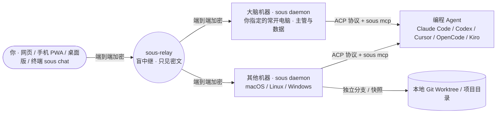

# sous

**你的副主厨：一个长期运行、随叫随到的私人 AI 助理与多编程 Agent 调度中枢。**

你是主厨，只管和它讨论需求、在关键节点拍板；`sous` 自己维护项目与任务、按预设调度你多台电脑和服务器上的 **Claude Code / Codex / Cursor / OpenCode / Kiro** 等编程 agent 并发干活，需要时找你审批，完成后带着结构化验证结果向你汇报，并在手机、电脑、网页与终端上随时可用。

> *sous* 取自法餐后厨的 *sous-chef*（副主厨）：你是主厨，它替你指挥各个岗位。

---

## 结构与工作流示意



```text
01 讨论需求          02 拆解与派发            03 Agent 隔离执行         04 分层审批               05 验收与按需交付
project_read /      task_create 选预设、     机器启动 ACP 会话，       本地底线拦截 → 审批 Agent   解析「## 结果」叫醒主管，
machine_look /  ──► 机器与执行位置       ──► 通过 sous mcp 实时   ──► 过滤常规操作 → 工作台  ──► 按你的指令执行 commit /
只读项目顾问 consult (worktree/就地/临时)     报进度、向主管提问        卡片一键「允许 / 拒绝」     merge / push / 开 PR
```

---

## 核心能力

1. **零信任（决策 0030、0031、0033）**：服务器上只有一个看不到数据、也控制不了任何机器的盲中继；主管在你指定的“大脑机器”上思考，按租约自动选主；每台机器只接受你签名的指令，或你授权范围内的指令。每台设备用本机方式解锁：iPhone 用 Face ID，Android 用指纹，Mac 用触控 ID 或开机密码，Windows 用 PIN。详见 [零信任](architecture/trust.md)。
2. **统一调度多家编程 Agent（ACP）**：通过标准 Agent Client Protocol 驱动本机已安装并登录的 **Claude Code**、**Codex**、**Cursor**、**OpenCode**、**Kiro**，也可以在 `~/.sous/node.json` 的 `custom_agents` 中接入任意自定义 ACP agent。常用的「agent + 模型 + 思考强度」可保存为**预设**，由主管按在线电脑自动匹配。
3. **独立 Worktree 与就地快照隔离**：代码任务可在 `~/.sous/worktrees/<仓库名>/<id>/` 的独立分支（`sous/<标题>-<id>`）中执行，不触碰原工作区；就地任务（`in_place`）自动拍快照并支持一键恢复。任务做完后改动停在分支上，只有你明确发话才执行 `git_commit`、`git_merge`（仅快进）、`git_push` 或 `git_pr`，绝不擅自合并主分支。
4. **分层自动审批与本地安全底线**：机器本地的底线规则当场拒绝删主目录、格式化磁盘等高危命令；确定性规则识别凭据、外传、改远端、提权、受保护分支等硬信号，一律交你审批；常规操作由审批 agent 判断或按 `auto` 模式放行，需要你拍板的请求直接内嵌在工作台任务卡片上（「允许这一次 / 拒绝」）。
5. **主管闭环与跨端随叫随到**：子 agent 通过本地 `sous mcp` 实时报进度（`report_progress`）、遇到分歧向主管或你提问（`ask_supervisor`）、结束时提交结构化结果（`report_result`），事件自动叫醒主管继续推进。支持桌面三栏工作台、iOS Liquid Glass 风格的手机 PWA、桌面托盘版与本机终端 `sous chat`；断网期间事件持久化在本地 `outbox.jsonl`，重连后自动对账补发。

---

## 安装与快速开始

部署中继和页面、完成首次设置见 [部署](guides/deploy.md)。下面是接入一台电脑。

### 1. 安装

**桌面版（macOS、Windows）**：从 [GitHub Releases](https://github.com/XiaoXianThis/Sous/releases) 下载 `sous-desktop_<版本>_<系统>_<架构>.zip`，里面带着 `sous`，配对后会在后台自动运行它。

**命令行（服务器，或者不想要托盘）**：一键安装脚本会下载对应平台的二进制、校验 `checksums.txt` 并安装到 `~/.local/bin`（已安装则原地更新并重启服务）：

```sh
curl -fsSL https://raw.githubusercontent.com/XiaoXianThis/Sous/main/work/scripts/install-sous.sh | sh
```

Windows PowerShell：

```powershell
irm https://raw.githubusercontent.com/XiaoXianThis/Sous/main/work/scripts/install-sous.ps1 | iex
```

### 2. 配对并常驻运行

在网页上打开 **设置 → 机器 → 添加机器**，复制显示的配对命令（10 分钟内有效），在这台电脑上执行：

```sh
# 配对并指定项目工作空间目录（服务器接入可追加 --role server）
sous pair https://relay.example.com sous1-abcd… --name 我的笔记本 --workspace ~/Code

sous agents            # 检查本机已安装且已登录的编程 agent
sous service install   # 注册后台常驻服务（macOS LaunchAgent / Linux systemd 用户服务 / Windows 服务）
sous service start
sous status
sous chat              # 在终端里和 sous 对话、处理审批
```

详细步骤见 [接入一台电脑或服务器](guides/connect-machine.md)。

### 3. 从源码构建

本仓库遵循 [wokspace](https://wokspace.wxian.cc) 规范，包含 `apps/core`（Go 核心）、`apps/web`（React PWA）、`apps/desktop`（Wails v3 桌面托盘版）和 `apps/site`（Astro 官网与文档站）：

```sh
git clone https://github.com/XiaoXianThis/Sous.git
cd Sous

wok ls                          # 查看所有应用及其任务
wok build web                   # 构建页面 -> build/web/
wok build core                  # 构建本机 sous 与 sous-relay -> build/core/
wok run core build-relay-linux  # 交叉编译 Linux 中继 -> build/core/linux-amd64/sous-relay
wok build desktop               # 打包桌面版（macOS）-> build/desktop/
wok build site                  # 构建官网与文档站 -> build/site/
```

---

## 文档索引

- **使用与运维指南（[guides/README.md](guides/README.md)）**
  - [部署（中继 + Vercel + 大脑机器）](guides/deploy.md)
  - [接入一台电脑或服务器](guides/connect-machine.md)
  - [macOS 签名与隐私权限](guides/macos-signing-and-permissions.md)
- **系统架构（[architecture/README.md](architecture/README.md)）**
  - [工作台：项目、预设、任务和机器](architecture/workbench.md)
  - [主管的上下文](architecture/supervisor-context.md)
  - [零信任：中继、大脑和机器](architecture/trust.md)
- **架构决策记录（[decisions/README.md](decisions/README.md)）**
  - ADR `0001`–`0033`（常驻架构、ACP 子 agent、权限模式、自动审批分层、长上下文、MCP、预设与主管闭环、话题、零信任与去中心化大脑、本机 Passkey 解锁等）
- **应用间接口契约（[api/README.md](api/README.md)）**
  - [core-relay](api/core-relay.md) · [sous-envelope](api/sous-envelope.md) · [core-brain-rpc](api/core-brain-rpc.md)
  - [core-hub-http](api/core-hub-http.md) · [core-hub-node](api/core-hub-node.md) · [core-daemon-ipc](api/core-daemon-ipc.md)
- **仓库与代理规范**：[AGENTS.md](../AGENTS.md) · [apps/README.md](../apps/README.md)

进行中或已完成的设计规格位于 `work/specs/`；Super-agent 参考对照见 `work/agent/rules/super-agent-reference.md`。

---

## License

Released under the [MIT License](../LICENSE).
