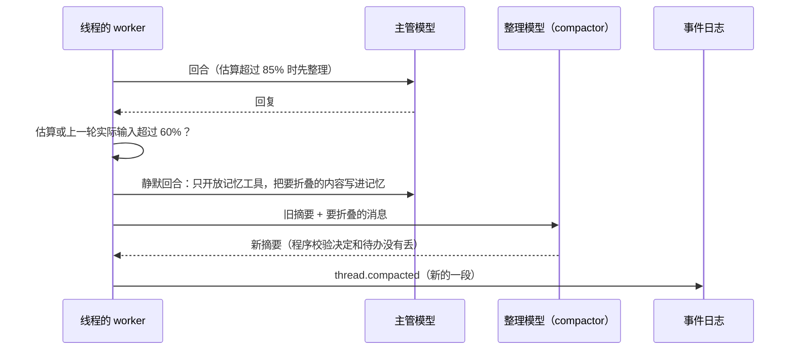

# 主管的上下文

主管每一轮调用模型时发什么，以及一条很长的对话（尤其是主线）怎么一直聊下去。代码在 `apps/core/internal/supervisor`（`context.go`、`compact.go`、`summary.go`），决策见 [0020](../decisions/0020-long-thread-context.md)。

## 一轮请求

- 系统提示只按线程种类和项目变化（`prompts.Supervisor`）。
- 本轮环境（`prompts.Tail`）接在最新那条用户消息后面，作为单独的一段文本：时间、机器和任务、召回的相关记忆、这一段里新增或删除的画像记忆。它不存进消息表，下一轮换成新的，所以前面的内容逐字节不变，能命中提示缓存。
- 已回答的消息超过 4000 字时，只发开头和结尾各 1500 字，中间提示用 `thread_read` 看全文。
- `provider.Request.CacheAt` 标出 Anthropic 的缓存断点（段首块、上一轮的末尾、请求末尾），系统提示总是缓存；其他供应商按前缀自动缓存，忽略这个字段。

## 分段和整理

- 段存在 `thread_segments`，由 `thread.compacted` 投影而来。每轮读最新的一段和 `covers_up_to` 之后的全部消息。
- 折叠范围：至少保留最近 10 条用户消息，而且保留的原文不少于窗口的 25%、不多于 40%。切在用户消息前面；回复跟着它回答的那条消息一起折叠；还没回答的消息不折叠。手动整理不要求 25%；模型报超长后只保留 4 条用户消息。
- 要折叠的内容超过窗口的 35% 时分块，逐块写记忆、更新摘要。
- 整理、手动整理、改摘要都在线程自己的串行 worker 里执行（`Supervisor.enqueue`），不会和回合同时进行。
- 失败时这一轮从最老的消息开始略去，下一轮再试；连续失败 3 次在对话里提示用户一次。
- 线程第一次进入这套机制时自动建第 1 段（原因 `start`）：太长的旧对话从最近能放下的地方开始，更早的部分没有摘要，但能搜到。

## 摘要

固定栏目（`prompts.SummarySections`）：已做的决定、待办和承诺、用户的偏好和纠正、进行中的话题、已完成或作废、其他背景。每条末尾带来源消息的编号 `[#seq]`。“已做的决定”和“待办和承诺”的条目只能移到“已完成或作废”，`missingItems` 按编号或开头文字核对，遗漏时让模型重写一次，仍然遗漏就由 `restore` 补回原栏目。

## 查回原文

- `thread_search {query, limit?, scope?}`：在当前对话里按子串匹配搜（中文按两字词），返回编号、时间和片段；主线里 `scope: "all"` 搜全部对话。
- `thread_read {seq, before?, after?}`：读一条消息的全文和前后几条。

## 窗口和角色

- 窗口是主管模型角色上的 `context_window`（设置 → 模型，默认 128000）。
- 估算偏高：中日韩文字每字按 1 token，其他文字每 4 字符按 1 token；回合结束后的判断还会参考上一次调用的实际输入。
- 摘要由 `compactor` 角色生成，没单独选模型时跟主管一样；写记忆的静默回合用主管的模型。两者的用量都记在 `compactor` 名下。
