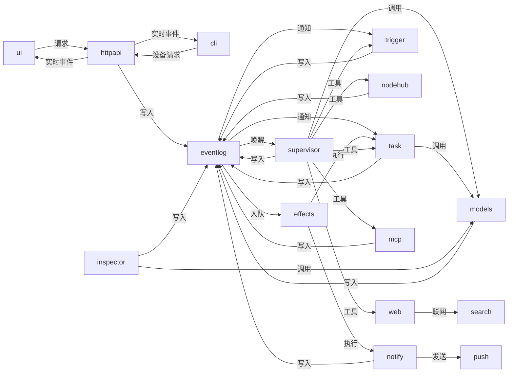

# 系统状态：模块之间怎么配合

设置里的“系统状态”列出系统模块的运行状态和它们之间的往来：每个参与者一行（状态、一句话说明），点开是弹窗。数据来自 core 的 `internal/sysmap`，把记录变成交接的规则在 web 的 `src/lib/coord.ts`（纯函数，有测试）。工作台的“现场”画的是人和事的流转，不是这些模块，见 [dispatch.md](dispatch.md)。决定见 `work/specs/system-map`。

## 数据：事件日志居中的星形

事件日志是领域数据的唯一写入者：各模块通过事件日志提交变更并通知监听者；直接调用和机器连接则以独立连线表示。

## 连线

| ID | 含义 |
|---|---|
| `ui>httpapi` | 页面调用的 REST 接口 |
| `cli>httpapi` | /api/v1/device/ 下的接口 |
| `httpapi>ui` | /ws 推给页面的事件 |
| `httpapi>cli` | /device/ws 推给命令行的事件 |
| `httpapi>eventlog` | 用户在页面上的操作产生的事件 |
| `supervisor>eventlog` | 回复、话题、记忆、整理 |
| `task>eventlog` | 任务、项目、Run 的创建和状态 |
| `trigger>eventlog` | 定时任务和跟进的触发 |
| `inspector>eventlog` | 巡检发现 |
| `nodehub>eventlog` | 机器上报的 Run 进展、审批请求、上下线 |
| `notify>eventlog` | 推送记录 |
| `mcp>eventlog` | MCP 服务的配置变化 |
| `models>eventlog` | 模型配置的变化 |
| `eventlog>supervisor` | 用户消息、触发、并入 |
| `eventlog>task` | Run 结束、任务状态、审批、机器上线 |
| `eventlog>trigger` | 定时任务的改动 |
| `eventlog>effects` | 需要后续处理的事件 |
| `effects>task` | 推进任务、审批、项目准备 |
| `effects>notify` | 推送 |
| `notify>push` | Web Push 请求 |
| `supervisor>models` | 主管和整理的模型调用 |
| `task>models` | 验收和审批的模型调用 |
| `inspector>models` | 巡检的模型调用 |
| `supervisor>task` | 任务、项目、git、顾问的工具调用 |
| `supervisor>trigger` | 定时任务的工具调用 |
| `supervisor>web` | web_search、web_fetch |
| `web>search` | 搜索和抓取网页 |
| `supervisor>mcp` | MCP 工具和管理 |
| `supervisor>nodehub` | machine_look |
| `models>provider:<名字>` | 发给供应商的模型请求 |
| `mcp>mcpserver:<slug>` | MCP 服务的工具调用 |
| `nodehub>machine:<id>` | 下发 Run 和控制帧 |
| `machine:<id>>nodehub` | 机器上报的进展和请求 |

## 状态从哪来

- 界面、命令行、接口：HTTP 与 WebSocket 连接。
- 事件日志：最新序号与写入速率。
- 副作用队列：待处理和失败的队列项。
- 推送、Web Push：最近推送次数。
- 主管：对话回合和工具活动。
- 任务引擎：各任务状态数量。
- 定时与跟进：启用的定时任务及下次执行时间。
- 巡检：最近巡检时间与发现。
- 模型路由、供应商：近期调用耗时和失败次数。
- MCP 客户端、MCP 服务：服务连接状态及工具数。
- 联网、搜索引擎：搜索配置与近期调用。
- 机器连接、机器：机器在线状态、运行中的 Run 和工位。

## 列表怎么分

- **参与者**：你（界面、命令行）、接口、事件日志和副作用队列、主管、模型（模型路由和供应商）、外部工具（联网、搜索、MCP）、任务引擎、机器连接、机器、定时与巡检、推送。弹窗里是每个模块的状态、近 15 分钟的往来次数、最近的往来。
- **交接**：写入事件日志和由它叫醒的模块合成一次交接（写入方 → 读取方）；直接调用（`sysmap.Callers` 记成 `<调用方>><写入方>`、摘要 `call <事件类型>`）是调用方到写入方的交接。页面轮询、推给页面的事件、帧确认、记账类事件不算。
- **颜色**：状态只用黑白灰和天蓝。
