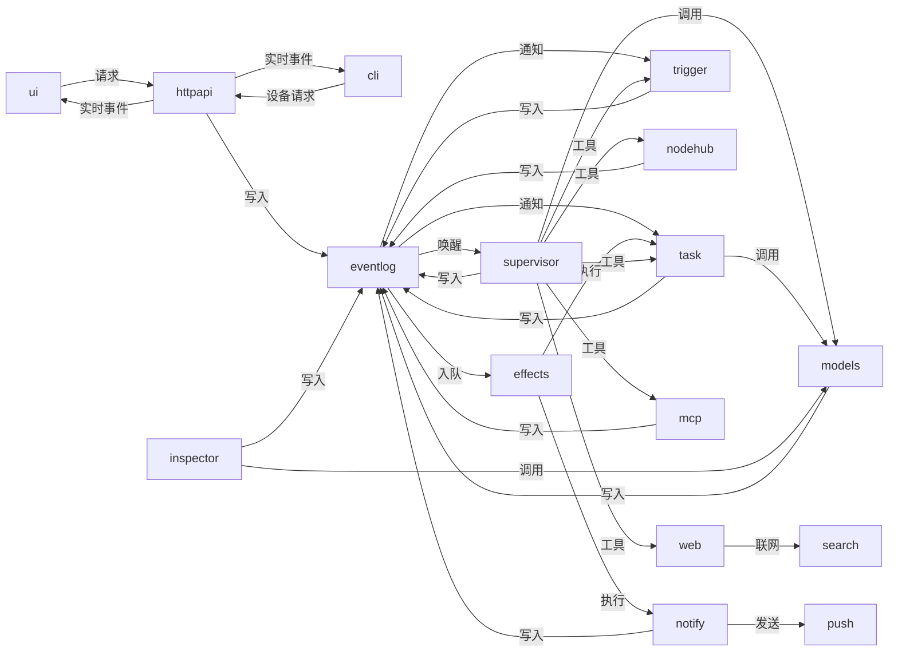

# 系统页：模块之间怎么配合

左侧图标栏的“系统”是一张实时的时序图（泳道图），不是拓扑图：每一列是一个参与者，时间往下走，每一行是一次交接——谁把什么交给了谁。数据来自 core 的 `internal/sysmap`，画法在 web 的 `src/lib/coord.ts`（纯函数，有测试）。决定见 `work/specs/system-map`。

## 数据：事件日志居中的星形

事件日志是领域数据的唯一写入者：各模块通过事件日志提交变更并通知监听者；直接调用和机器连接则以独立连线表示。

## 连线

| ID | 含义 |
|---|---|
| `ui>httpapi` | 页面调用的 REST 接口 |
| `cli>httpapi` | /api/v1/device/ 下的接口 |
| `httpapi>ui` | /ws 推给页面的事件 |
| `httpapi>cli` | /device/ws 推给命令行的事件 |
| `httpapi>eventlog` | 用户在页面上的操作产生的事件 |
| `supervisor>eventlog` | 回复、话题、记忆、整理 |
| `task>eventlog` | 任务、项目、Run 的创建和状态 |
| `trigger>eventlog` | 定时任务和跟进的触发 |
| `inspector>eventlog` | 巡检发现 |
| `nodehub>eventlog` | 机器上报的 Run 进展、审批请求、上下线 |
| `notify>eventlog` | 推送记录 |
| `mcp>eventlog` | MCP 服务的配置变化 |
| `models>eventlog` | 模型配置的变化 |
| `eventlog>supervisor` | 用户消息、触发、并入 |
| `eventlog>task` | Run 结束、任务状态、审批、机器上线 |
| `eventlog>trigger` | 定时任务的改动 |
| `eventlog>effects` | 需要后续处理的事件 |
| `effects>task` | 推进任务、审批、项目准备 |
| `effects>notify` | 推送 |
| `notify>push` | Web Push 请求 |
| `supervisor>models` | 主管和整理的模型调用 |
| `task>models` | 验收和审批的模型调用 |
| `inspector>models` | 巡检的模型调用 |
| `supervisor>task` | 任务、项目、git、顾问的工具调用 |
| `supervisor>trigger` | 定时任务的工具调用 |
| `supervisor>web` | web_search、web_fetch |
| `web>search` | 搜索和抓取网页 |
| `supervisor>mcp` | MCP 工具和管理 |
| `supervisor>nodehub` | machine_look |
| `models>provider:<名字>` | 发给供应商的模型请求 |
| `mcp>mcpserver:<slug>` | MCP 服务的工具调用 |
| `nodehub>machine:<id>` | 下发 Run 和控制帧 |
| `machine:<id>>nodehub` | 机器上报的进展和请求 |

## 状态从哪来

- 界面、命令行、接口：HTTP 与 WebSocket 连接。
- 事件日志：最新序号与写入速率。
- 副作用队列：待处理和失败的队列项。
- 推送、Web Push：最近推送次数。
- 主管：对话回合和工具活动。
- 任务引擎：各任务状态数量。
- 定时与跟进：启用的定时任务及下次执行时间。
- 巡检：最近巡检时间与发现。
- 模型路由、供应商：近期调用耗时和失败次数。
- MCP 客户端、MCP 服务：服务连接状态及工具数。
- 联网、搜索引擎：搜索配置与近期调用。
- 机器连接、机器：机器在线状态、运行中的 Run 和工位。

## 页面怎么画

- **泳道**：你（界面、命令行）、接口、主管、模型（模型路由和供应商）、外部工具（联网、搜索、MCP）、任务引擎、机器连接、机器、定时与巡检、推送；事件日志和副作用队列只在“显示底层细节”里出现。核心几列一直在，其余的只在有往来或不空闲时出现。列头是状态（图形 + 文字）和一句话说明，点开是这一列的弹窗：每个模块的状态、近 15 分钟的往来次数、最近的往来。
- **一行一次交接**：写入事件日志和由它叫醒的模块合成一条箭头（写入方 → 读取方）；没人读的写入是写入方那一列上的一个点。同一件事 3 秒内重复的折叠成一行，标 ×N。点一行是这次交接的弹窗：属于哪件事、原始记录。
- **直接调用**：模块之间不经事件日志的调用（任务引擎让机器连接开始一个 Run、任务引擎的接口被页面调用）由 `sysmap.Callers` 从调用栈找出“谁调用了写入方”，记成 `<调用方>><写入方>`、摘要 `call <事件类型>` 的记录，画成调用方 → 写入方的箭头。查找在事件日志、副作用队列、主管处停止（那之后的代码是事件或工具调用引起的，页面已经画了），机器的 websocket 不算接口的调用。
- **默认只看配合**：页面轮询、推给页面的事件、帧确认、记账类事件（已看到、用量、流式输出、工具记录）、机器连接对机器上报的复述、同一列内部的转发都不画；“显示底层细节”把它们全画出来。
- **哪件事**：每行按记录里的任务（Run 归到它的任务）、否则对话归组，左边一列写名字。点名字或用顶部的下拉只看一件事；任务详情、Run 详情、对话标题栏的“在系统页里追踪”打开的就是这个筛选。
- **颜色**：只用黑白灰和天蓝；刚到的行（2.5 秒内）是天蓝，其余是灰色。
- 手机和设置里是“系统状态”列表，点开同样是弹窗。
