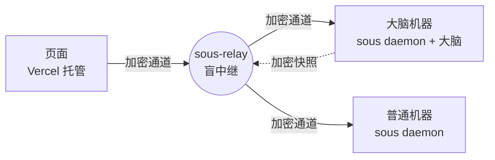

# 零信任：中继、大脑和机器

决策 0030 和 0031。目标是：服务器被攻破、拿到 root 甚至全部源码，也无法控制任何一台机器，也读不到任何数据。只有用户的指令（以及用户授权给 AI 的范围）会被执行。

## 组成

- **中继**（`internal/relay`，`sous-relay`）：转发密文、存放签名文档和加密快照，不持有任何有用的密钥。服务器上只运行这一个程序。
- **大脑**（`internal/brain`）：0.2 的 Hub 原样搬进 `sous daemon`，跑在内存监听器上，没有网络端口。只有被用户指定为大脑、并且持有租约的机器才会运行它。
- **机器**（`internal/node`）：通过 `internal/tunnel` 连到中继，只和当前租约的持有者建立帧流，并用守卫（`guard.go`）检查每一帧。
- **页面**（`apps/web/src/trust`）：用 Passkey 解锁身份，签发会话证书，经中继和大脑、机器直接通信。

## 谁信谁

| 信任根 | 在哪 | 用来做什么 |
|---|---|---|
| 用户的 Passkey | 用户的设备，每台设备一把本机的（决策 0033） | 用 PRF 解锁身份密钥（没有 PRF 的设备用设备密钥，见下）；对关键操作签断言 |
| 身份密钥 | 中继上只存加密后的身份包，解锁后才出现在页面内存里，而且是不可导出的 WebCrypto 密钥 | 签名册、自主范围、暂停、数据密钥、会话证书 |
| 名册 | 中继保存它的每个版本，机器各自保存验证过的副本 | 列出“谁是自己人”。机器固定的是身份公钥，配对时由用户亲手把它的指纹带到机器上 |
| 发布密钥 | 作者自己的电脑（`~/.config/sous/release-key.json`），不进仓库、不进 CI | 给 `checksums.txt` 签名；机器只安装签过名的版本 |

## 解锁（决策 0033）

每台设备有自己的本机 Passkey：iPhone 用 Face ID，Android 用指纹，Mac 用触控 ID 或开机密码，Windows 用 PIN。页面记住这台设备的 Passkey，解锁时只请求它，浏览器就不会弹“用手机扫码”。新设备第一次要用已有的 Passkey（通常是手机）解锁，再在信任页“让这台设备直接解锁”。

- **有 PRF**：PRF 输出包装身份密钥，中继上的身份包里多一份包装。
- **没有 PRF**（大多数版本的 Windows Hello）：浏览器生成不可导出的设备密钥（IndexedDB），用它加密身份；密文放在中继的 `devwrap` 里，中继核对这把 Passkey 对一次性挑战的断言（UV 为 1）后才交出。解开身份需要这台设备的浏览器数据加上 Windows Hello（或者中继），比 PRF 弱一档，信任页上标为“设备密钥”。

## 授权的三档（机器自己检查）

1. **自主范围内**：大脑发出的 `run.start` 在用户签名的自主范围内（机器、最高权限模式、合并、运维、open 模式），机器直接执行。
2. **范围外**：机器拒绝，错误以“超出自主范围：”开头。用户可以发一个 `run` 许可（按任务）放行一次。
3. **关键操作**：打开终端、安装或登录 agent、写 API Key、写配置、修改角色或工作空间、更新、解冻、修改名册或自主范围、开放机器的终端对话，都需要带 WebAuthn 断言（UV 位必须为 1）的许可，验证方自己核对断言。许可写明批准的内容（API Key、配置文件内容按哈希），大脑拿着许可也换不了内容。

## 普通机器能看到什么

机器上的 `sous chat` 以机器身份调用大脑的设备接口，不需要用户在场。所以名册给每台机器一个 `console` 开关：打开时，这台机器的终端能看全部对话、处理所有审批；关闭时，它只能记笔记、处理本机 Run 的审批。配对时个人电脑默认打开，服务器默认关闭；之后在信任页切换，打开要刷 Face ID，关闭不用。大脑机器本来就持有数据密钥，不受这个开关限制。

收紧权限不需要 Face ID：冻结机器、全部暂停都可以直接做。机器在 10 分钟内收到 3 次越权指令会自我冻结，并发布签名警报，要用户刷 Face ID 才能解除。

## 数据

- 页面和机器的通信、机器和大脑之间的帧流，全部走 HPKE（X-Wing）开出的通道，用 AES-GCM 逐条加密，序号防重放。发送方每小时或每 10 万条消息换一条通道；通道密钥封装给接收方的长期 KEM 密钥，所以还没有前向保密（见已知限制）。
- 大脑的状态（Hub 的数据目录）定期打成加密快照上传中继，数据密钥按时期轮换，只包装给用户和大脑机器。普通机器不持有数据密钥。
- 快照按内容切块（gear 滚动哈希，平均 64 KB），每块单独压缩、加密，块名是用数据密钥算的内容哈希。数据库只改了几行时，只有附近的几块要上传；中继只保留最新两份清单用到的块。中继能看出两份快照之间哪些块没变，看不到内容，也没法验证对内容的猜测。
- 项目文件不加密，留在各台机器上，照常推送到 GitHub。

## 大脑选举

用户在名册里指定大脑机器和它们的优先级。当没有有效租约时，在线的、优先级最高的大脑机器声明 `term+1` 的租约（有效 90 秒，每 30 秒续一次）。如果优先级更高的机器迟迟不接手，排在后面的会自己接。新上任的大脑会恢复最新的快照，把名册同步进 Hub。机器发现租约换了人，就断开帧流、重新连接新的大脑。

## 中继能做和不能做的

能做：拒绝服务；看到元数据（谁在线、什么时候、多少字节）。

不能做，而且已有测试覆盖（`internal/brain/adversary_test.go`、`e2e_test.go`、`internal/tunnel`、`internal/trust`）：
- 伪造或重放指令，包括机器重启之后再重放
- 把密文挪给别的机器
- 伪造租约
- 回滚名册或自主范围
- 不带断言就放宽自主范围
- 在配对时冒充任何一方
- 读到明文

## 已知限制（0.3.0-alpha1）

- 机器的密钥存在文件里（权限 0600），没有放进 Secure Enclave 或 TPM（Go 访问这些硬件需要开 cgo），页面上标注为“软件密钥”。
- 快照只有一个数据域，所有大脑机器都能读全部数据，还不能按项目排除。
- 页面没有离线缓存：大脑全部离线时，页面上只能管理机器（冻结、踢出）和全部暂停。
- 还没有用二维码配对、页面资源清单签名。
- 机器之间的通道没有前向保密：通道密钥封装给接收方的长期 KEM 密钥，以后偷到那台机器的 `keys.json`，就能解开事先录下的发给它的流量。通道每小时换钥只限制了单把通道密钥泄露的范围。页面会话的密钥每次解锁都换，不受影响。
- 浏览器端的 ML-KEM 实现（`@noble/post-quantum`）只经过作者自审。由于采用 X-Wing 混合方案，即使这一半有缺陷，X25519 那一半仍然有效。
