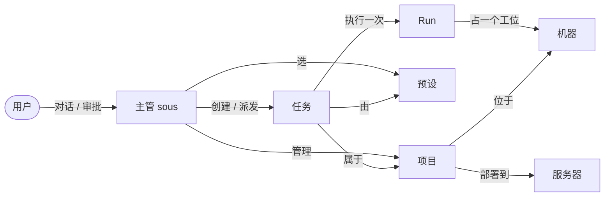
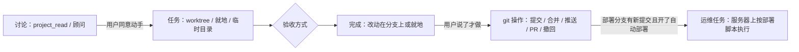

# 工作台：项目、预设、任务和机器

sous 的使用逻辑：用户只和主管（sous）对话、做决定；sous 管理项目、预设（agent + 模型）和任务，并决定在哪台机器上干活。界面以“工作台”为主体，聊天在边栏。

## 实体

| 实体 | 是什么 | 存在哪 |
|---|---|---|
| 项目 | 一个 git 仓库，身份是规范化后的远端地址（`internal/project.Key`）；记着它在哪些机器的哪个目录、部署到哪台服务器、默认预设和说明。内置的 `misc`（杂项）收容不属于任何仓库的任务 | `projects`、`project_nodes` |
| 预设 | 用户常用的“agent + 模型”组合：agent、会话选项（模型、思考强度）、定位（给主管挑选用，不进 agent 的提示）、默认权限模式。和机器无关，主管按它能在哪些电脑上用来挑（decisions/0024，取代 0013 的岗位） | `personas` |
| 任务 | 管理单元，属于一个项目，可以指定预设，也可以单独指定模型和思考强度（`options`）。没有固定流程（decisions/0022），由主管按场景定下几个属性：在哪儿做（`worktree` 独立分支 / `in_place` 在项目目录里就地改，先拍快照 / `scratch` 临时目录）、从哪个分支开始（`worktree` 时的 `base_branch` + `base_from`）、要不要验收（默认不验收；验收模型看 diff / 验收 agent 只读地跑测试 / 用户，decisions/0024）和不通过时怎么办（默认返工 / 停下商量）。“代码 / 一般 / 运维”只是标签。任务做完改动就留在分支上（或就地），提交、合并、推送、开 PR 是单独的 git 操作 | `tasks` |
| Run | 执行单元：一个 agent 在某台机器上做一次任务，就是一个 ACP 会话。还有不属于任务的 Run：项目顾问（只读、常驻的会话）和 git 操作（Node 执行写死的命令） | `runs` |
| 机器 | 开发机或服务器；有工作空间（找仓库、放新项目的目录）和并发上限（工位数） | `nodes`、`repo_scans` |

## 项目怎么到机器上

- 每台开发机在 `node.json` 里设置工作空间。daemon 扫描工作空间（往下两层），把找到的仓库报给 Hub（`node.repos`）。远端地址和某个项目一致的仓库，自动成为这个项目在这台机器上的位置（`project_nodes.source = scan`）；没登记的出现在“发现的仓库”里。
- sous 可以新建项目（默认 `wok init`，[wokspace](https://github.com/XiaoXianThis/wokspace) 规范）或把项目 clone 到另一台开发机，都由 Node 在第一个工作空间里执行写死的命令，经过本地策略。
- 路由：机器角色是偏好，不是规则：`worktree` 和 `scratch` 先找开发机、运维标签的就地任务先找服务器，候选里没有这种角色的机器时才用另一种；指定了机器就用那台。同一个任务的后续 Run（包括验收）留在持有分支或快照的机器上；同一个目录同时只跑一个就地任务。服务器上的严格策略跟着机器走，不看任务标签。

## 讨论、做事和交付

用户只和主管对话（decisions/0022）。主管判断这是讨论还是要动手：

- **讨论**：一两个文件的问题主管用 `project_read` 自己读（Node 上的读文件、列目录、grep）；要通读代码、连续讨论时用 `consult` 问**项目顾问**：一个在项目所在开发机上、只读（`readonly` 档位，Node 强制）的 agent 会话，每个项目一个，问题之间空闲等待，空闲久了停掉 agent、保留会话 id，下一个问题再加载。顾问的回答以 `kind: consult` 的消息原样显示，主管不复述。顾问不占机器的并发槽位。
- **动手**：指令明确时主管建任务、选属性；拿不准先问。讨论转成的任务带上顾问的会话（`from_consult`），读过代码的 agent 接着做。
- **验收**：按任务的 `review`：模型看 diff，或者派验收预设的 agent 在同一个目录里跑一次只读加测试的 `verify` Run，或者等用户在任务详情或对话里给结论。
- **交付**：任务结束时改动在分支上（或就地）。用户说了才做 git 操作，单人或多人项目都一样：`git_commit`、`git_merge`（rebase 后只快进目标分支，冲突时什么都不改）、`git_push`（从不 force）、`git_pr`、`git_undo`（只撤回没推送的）、`git_discard`、`task_restore`（就地任务按快照恢复）。分支和远端都由主管看 `git_status` 和对话判断后明确给出，不预设 main；有歧义就问用户，问过的答案记成项目的习惯。

项目打开自动部署时，要指定部署分支：机器每次扫描都上报 origin 各分支的提交（fetch、sous 推送之后），部署分支出现新提交就建一个运维任务部署这个提交，每个提交一次；第一次看到的提交只记下来、不部署。也可以在项目页点“部署”或在对话里让 sous 部署。

## 界面

- 桌面三栏：左侧图标栏（工作台、对话、机器状态、深浅色切换、设置），中间是工作台，右侧聊天（可收起、可拖动调宽）。每个项目还有自己的项目对话，停靠在项目弹窗的右侧：对话的还是 sous，但它只看得到、也只会动这个项目（建的任务都归到这个项目），所以项目里的事不用每次说明是哪个项目。手机是悬浮在底部的玻璃标签栏：工作台、对话、设置（往下滚时缩成一个圆）；手机的外观和触屏行为见 [0018](../decisions/0018-phone-liquid-glass.md)。
- 工作台是唯一的业务页面，只有一页：顶部标题行是几个图标加数字的概况和“+ 项目”，“要你处理”（待审批和收件箱里的任务）默认收起、点图标弹出 popover，页面里只有按项目排列的卡片，等高网格布局（不是瀑布流）；卡片里是位置（开发机 / 部署目标 / 远端）、正在工作的子 agent 和任务。任务行两行高，显示任务状态、最近一次运行的状态和接手的 agent（图标 + 名称），不画阶段进度条；阶段进度只在任务详情里。
- 项目分“激活”和“已归档”。工作台只显示激活的项目；标题行“+ 项目”旁边的“打开”弹出已归档的项目：按上次修改时间排列、可以按名字 / 说明 / 仓库搜索，卡片和工作台上的一样，只多一个“已归档”标记，照样能查看、编辑，点“激活”放回工作台。归档在项目弹窗或项目设置里。归档状态是单独的 `project.archived` 事件，`project.put` 不会改掉它；在已归档的项目里建任务会自动激活。主管的环境说明只列激活的项目，已归档的只列名字，用户明确提到才处理（`project_archive` 工具归档或激活）。
- 每张项目卡片右下角是上次修改时间（`touched_at`：项目或它的任务最后一次改动），显示成“3 分钟前”“4 小时前”“2 天前”“3 个月前”“1 年前”。
- 任务只有四种状态：待办、进行中、要你处理、已结束；详细状态（排队、验收中、等你验收、暂停、失败、未合并、已合并、PR 已开）只作为 badge 的补充文字，不按状态分栏。“等你验收”算要你处理；分支没合并不算，项目卡上另外显示“N 未合并”。任务详情里有“怎么做”（在哪儿做、从哪儿开始、分支和去向、验收方式）和等你验收时的“通过 / 要改”。
- 项目的机器位置标签上标出 checkout 的状态：↓ 落后远端、↑ 没推送、● 没提交（daemon 每 10 分钟在后台 fetch）。点开可以“同步”（只快进，有改动或分叉就不动）或者“存成 WIP 分支”（推到 `sous/wip/…`，本地不变）。任务分支从哪里开始由主管明确给出（本地分支或 origin 上的）；同一项目两个任务（包括做完但没合并的）改到同一个文件时，sous 提醒主管决定要不要排队。
- 项目弹窗有“任务 / 详情 / 终端”三个标签（卡片上只有前两个）。“终端”在项目目录里开本机 shell：每个终端一个标签，“+”在项目所在的机器里选一台；打开要 15 分钟内验证过 Passkey，终端只属于打开它的登录会话，命令不经过权限策略，输出不保存（`docs/decisions/0015`）。
- 运行中的 Run 在卡片里展开成 agent 卡：预设、agent、模型、思考强度、机器和 2 行实时活动；点击打开 Run 详情。
- 任务和项目详情是 sheet：`#/task=<id>` 打开任务，`#/project=<id>` 打开项目，`#/inbox` 滚动到“要你处理”；浏览器返回关闭。
- 聊天里一个 Run 只占一行（头像、状态、机器、步数），点开去项目弹窗里的任务详情；git 操作显示成“合并到 feature-x”这样的一行。项目顾问的回答是左侧带色条、标着“agent · 顾问 · 项目”的消息，长回答先折叠。审批不在聊天里显示（Run 那一行只标“等你审批”）：它出现在工作台上那个任务的卡片里，占输出摘要的位置、卡片高度不变，可以当场“允许 / 拒绝”，其余选项在任务详情里；也出现在“要你处理”里。
- 发消息时带上工作台上正在看的项目或任务（消息的 `context`），主管据此理解“这个”。
- 状态的图标和颜色集中在 `apps/web/src/lib/status.ts`，四种任务状态也在那里；所有页面共用。
- 设置是一个居中弹窗（手机上是第三个标签：分组列表，点进去推入各页），点击外部不会关闭：机器（角色、工作空间、agent 管理）、模型（供应商、角色模型和思考强度）、预设、MCP、定时任务、记忆、用量、通知与默认、外观（跟随系统 / 浅色 / 深色）、账号。
- 视觉参照 Cursor 主题：灰色框架、白色内容和卡片，用深浅和细线表示层级；强调色只有天蓝色，琥珀色只表示“要你处理”。
