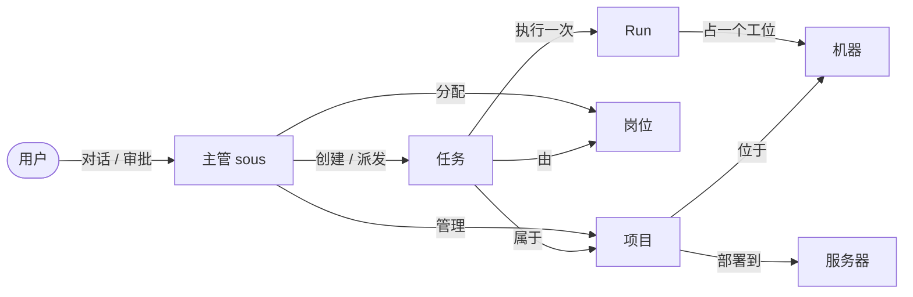
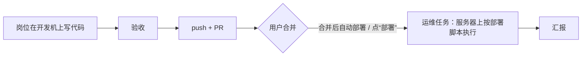

# 工作台：项目、岗位、任务和机器

sous 的使用逻辑：用户只和主管（sous）对话、做决定；sous 管理项目、岗位（人员）和任务，并决定在哪台机器上干活。界面以“工作台”为主体，聊天在边栏。

## 实体

| 实体 | 是什么 | 存在哪 |
|---|---|---|
| 项目 | 一个 git 仓库，身份是规范化后的远端地址（`internal/project.Key`）；记着它在哪些机器的哪个目录、部署到哪台服务器、默认岗位和说明。内置的 `misc`（杂项）收容不属于任何仓库的任务 | `projects`、`project_nodes` |
| 岗位 | 可配置的“人”：agent、会话选项（模型、思考强度）、岗位说明、默认权限模式、适合的任务类型。和机器无关（decisions/0013） | `personas` |
| 任务 | 管理单元，属于一个项目、分给一个岗位。类型：代码（worktree → 验收 → PR）、一般（临时目录 → 验收）、运维（服务器上就地执行，decisions/0014） | `tasks` |
| Run | 执行单元：一个岗位在某台机器上做一次任务，就是一个 ACP 会话 | `runs` |
| 机器 | 开发机或服务器；有工作空间（找仓库、放新项目的目录）和并发上限（工位数） | `nodes`、`repo_scans` |

## 项目怎么到机器上

- 每台开发机在 `node.json` 里设置工作空间。daemon 扫描工作空间（往下两层），把找到的仓库报给 Hub（`node.repos`）。远端地址和某个项目一致的仓库，自动成为这个项目在这台机器上的位置（`project_nodes.source = scan`）；没登记的出现在“发现的仓库”里。
- sous 可以新建项目（默认 `wok init`，[wokspace](https://github.com/XiaoXianThis/wokspace) 规范）或把项目 clone 到另一台开发机，都由 Node 在第一个工作空间里执行写死的命令，经过本地策略。
- 路由：代码和一般任务只去开发机，运维任务只去服务器；同一个任务的后续 Run 留在持有分支的机器上。

## 代码从写到部署

sous 永远不合并 PR。项目打开“合并后自动部署”时，Hub 定时请开发机用 `gh` 查 PR 是否合并，合并后建运维任务。

## 界面

- 桌面三栏：左侧图标栏（工作台、对话、机器状态、深浅色切换、设置），中间是工作台，右侧聊天（可收起、可拖动调宽）。每个项目还有自己的项目对话，停靠在项目弹窗的右侧：对话的还是 sous，但它只看得到、也只会动这个项目（建的任务都归到这个项目），所以项目里的事不用每次说明是哪个项目。手机是底部三个标签：工作台、对话、设置。
- 工作台是唯一的业务页面，只有一页：顶部标题行是几个图标加数字的概况和“+ 项目”，“要你处理”（待审批和收件箱里的任务）默认收起、点图标弹出 popover，页面里只有按项目排列的卡片，等高网格布局（不是瀑布流）；卡片里是位置（开发机 / 部署目标 / 远端）、正在工作的子 agent 和任务。任务行两行高，显示任务状态、最近一次运行的状态和接手的 agent（图标 + 名称），不画阶段进度条；阶段进度只在任务详情里。
- 项目分“激活”和“已归档”。工作台只显示激活的项目；标题行“+ 项目”旁边的“打开”弹出已归档的项目：按上次修改时间排列、可以按名字 / 说明 / 仓库搜索，卡片和工作台上的一样，只多一个“已归档”标记，照样能查看、编辑，点“激活”放回工作台。归档在项目弹窗或项目设置里。归档状态是单独的 `project.archived` 事件，`project.put` 不会改掉它；在已归档的项目里建任务会自动激活。主管的环境说明只列激活的项目，已归档的只列名字，用户明确提到才处理（`project_archive` 工具归档或激活）。
- 每张项目卡片右下角是上次修改时间（`touched_at`：项目或它的任务最后一次改动），显示成“3 分钟前”“4 小时前”“2 天前”“3 个月前”“1 年前”。
- 任务只有四种状态：待办、进行中、要你处理、已结束；详细状态（排队、验收中、暂停、失败、PR 待合并）只作为 badge 的补充文字，不按状态分栏。
- 项目的机器位置标签上标出 checkout 的状态：↓ 落后远端、↑ 没推送、● 没提交（daemon 每 10 分钟在后台 fetch）。点开可以“同步”（只快进，有改动或分叉就不动）或者“存成 WIP 分支”（推到 `sous/wip/…`，本地不变）。代码任务总是从远端的最新代码开分支；同一项目两个任务改到同一个文件时，sous 提醒主管决定要不要排队。
- 项目弹窗有“任务 / 详情 / 终端”三个标签（卡片上只有前两个）。“终端”在项目目录里开本机 shell：每个终端一个标签，“+”在项目所在的机器里选一台；打开要 15 分钟内验证过 Passkey，终端只属于打开它的登录会话，命令不经过权限策略，输出不保存（`docs/decisions/0015`）。
- 运行中的 Run 在卡片里展开成 agent 卡：岗位、agent、模型、思考强度、机器和 2 行实时活动；点击打开 Run 详情。
- 任务和项目详情是 sheet：`#/task=<id>` 打开任务，`#/project=<id>` 打开项目，`#/inbox` 滚动到“要你处理”；浏览器返回关闭。
- 聊天里一个 Run 只占一行（头像、状态、机器、步数），点开去项目弹窗里的任务详情；需要当场处理的审批仍以卡片显示在聊天里，也出现在工作台的“要你处理”里。
- 发消息时带上工作台上正在看的项目或任务（消息的 `context`），主管据此理解“这个”。
- 状态的图标和颜色集中在 `apps/web/src/lib/status.ts`，四种任务状态也在那里；所有页面共用。
- 设置是一个居中弹窗（手机上全屏），点击外部不会关闭：机器（角色、工作空间、agent 管理）、岗位、定时任务、记忆、用量、通知与默认、外观（跟随系统 / 浅色 / 深色）、账号。
- 视觉参照 Cursor 主题：灰色框架、白色内容和卡片，用深浅和细线表示层级；强调色只有天蓝色，琥珀色只表示“要你处理”。
