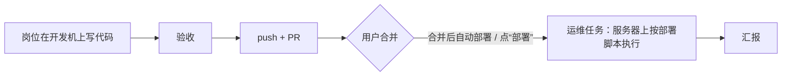

# 工作台：项目、岗位、任务和机器

sous 的使用逻辑：用户只和主管（sous）对话、做决定；sous 管理项目、岗位（人员）和任务，并决定在哪台机器上干活。界面以“工作台”为主体，聊天在边栏。

## 实体

| 实体 | 是什么 | 存在哪 |
|---|---|---|
| 项目 | 一个 git 仓库，身份是规范化后的远端地址（`internal/project.Key`）；记着它在哪些机器的哪个目录、部署到哪台服务器、默认岗位和说明。内置的 `misc`（杂项）收容不属于任何仓库的任务 | `projects`、`project_nodes` |
| 岗位 | 可配置的“人”：agent、会话选项（模型、思考强度）、岗位说明、默认权限模式、适合的任务类型。和机器无关（decisions/0013） | `personas` |
| 任务 | 管理单元，属于一个项目、分给一个岗位。类型：代码（worktree → 验收 → PR）、一般（临时目录 → 验收）、运维（服务器上就地执行，decisions/0014） | `tasks` |
| Run | 执行单元：一个岗位在某台机器上做一次任务，就是一个 ACP 会话 | `runs` |
| 机器 | 开发机或服务器；有工作空间（找仓库、放新项目的目录）和并发上限（工位数） | `nodes`、`repo_scans` |

## 项目怎么到机器上

- 每台开发机在 `node.json` 里设置工作空间。daemon 扫描工作空间（往下两层），把找到的仓库报给 Hub（`node.repos`）。远端地址和某个项目一致的仓库，自动成为这个项目在这台机器上的位置（`project_nodes.source = scan`）；没登记的出现在“发现的仓库”里。
- sous 可以新建项目（默认 `wok init`，[wokspace](https://github.com/XiaoXianThis/wokspace) 规范）或把项目 clone 到另一台开发机，都由 Node 在第一个工作空间里执行写死的命令，经过本地策略。
- 路由：代码和一般任务只去开发机，运维任务只去服务器；同一个任务的后续 Run 留在持有分支的机器上。

## 代码从写到部署

sous 永远不合并 PR。项目打开“合并后自动部署”时，Hub 定时请开发机用 `gh` 查 PR 是否合并，合并后建运维任务。

## 界面

- 桌面三栏：左侧图标栏（总览、项目、待处理、设置），中间工作台，右侧聊天（可收起）。手机是底部四个标签：对话、总览、待处理、设置。
- 总览是“项目 × 机器”的格子，格子里是正在干活的岗位头像，头像外圈和角标表示状态；项目页是任务看板，每张卡片有阶段进度条；任务页有阶段时间线和每个 Run 的全部步骤。
- 聊天里一个 Run 只占一行（头像、状态、机器、步数），点开去任务页；需要当场处理的审批仍以卡片显示在聊天里。
- 发消息时带上工作台上正在看的项目或任务（消息的 `context`），主管据此理解“这个”。
- 状态的图标和颜色集中在 `apps/web/src/lib/status.ts`，所有页面共用。
- 设置是一个全屏弹窗：机器（角色、工作空间、agent 管理）、岗位、定时任务、记忆、用量、通知与默认、账号。
