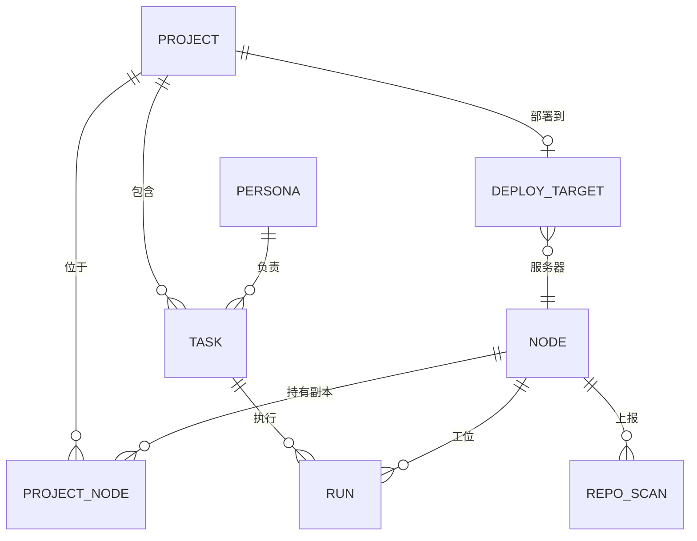

# M5 工作台：设计

需求见 `requirements.md`。本文写怎么做。M4 及以前的设计见 `work/specs/sous-mvp/design.md`，这里只写变化。标了「待验证」的地方，开工时先实测再定稿。

## 1. 实体关系



- 机器的“工位”不是表，就是机器的并发上限（`node.json` 的 `concurrency`），总览里按正在执行的 Run 画出来。
- 所有新数据仍然只经 `eventlog.Log` 写入：新增事件类型、投影视图，迁移只在末尾追加。

## 2. 数据模型变化

```sql
-- 新表
personas(id, name, glyph, color, agent, model, effort, brief, default_mode,
         kinds_json, builtin, created_at, updated_at)
repo_scans(node_id, path, remote, remote_key, branch, dirty, seen_at,
           PRIMARY KEY (node_id, path))          -- daemon 上报的仓库，投影自 node.repos
deploy_targets(project_id PRIMARY KEY, node_id, path, deploy_cmd, health_cmd,
               auto_on_merge, updated_at)

-- 改动
projects      + remote_key TEXT (唯一，可为空：单机项目)、default_persona、notes、layout ('wokspace' / '')
project_nodes + source TEXT ('manual' / 'scan')
tasks         + persona_id；kind 增加 'ops'
nodes         + role TEXT ('dev' / 'server'，默认 'dev')、workspaces_json
```

**新事件**：`persona.put` `persona.deleted` `node.repos`（扫描结果，整台机器一次） `deploy.put` `project.cloned`。项目继续用 `project.put` / `project.deleted`。

**内置项目**：迁移时插入一个 id 固定的“杂项”项目（没有 remote、没有机器位置），一般任务没有项目时归到这里。

**remote 规范化**（`internal/project` 新包，纯函数，Hub 和 Node 共用）：去掉协议和用户名，`git@host:a/b` 转成 `host/a/b`，去掉 `.git` 和末尾的 `/`，主机名转小写。路径部分大小写保留（GitLab 等区分大小写）。

## 3. 工作空间扫描（Node）

- `node.json` 加 `workspaces: ["~/Code"]`，加载时转成绝对路径。远程修改走 M4 的 node.json 编辑接口，`Daemon.apply` 生效后立即重扫。
- 扫描：每个工作空间往下最多两层，遇到含 `.git` 的目录就记下并不再往下；跳过 `node_modules`、隐藏目录、符号链接。每个仓库读 `git remote get-url origin`（没有 origin 取第一个 remote）、当前分支、`git status --porcelain` 是否为空。
- 上报 `node.repos`（全量，Hub 端整机替换）。时机：上线、工作空间变化、每 10 分钟；结果和上次相同时不报。
- Hub 投影：`repo_scans` 整机替换；对 `remote_key` 已登记的项目，`project_nodes` 里 upsert 一行 `source = 'scan'`（不覆盖 `manual` 的行和优先级）；仓库消失时删掉 `scan` 来源的行。
- 扫描时顺带判断仓库是不是 wokspace（根目录有 `AGENTS.md` 和 `apps/`、`build/`、`docs/`、`work/`），上报为 `wokspace: true`，投影到 `projects.layout`（`'wokspace'` / 空）。
- 新建项目：Hub → Node 请求 `repo.create {project_id, name, layout: 'wokspace', remote?: {owner, private}}`。Node 在第一个工作空间下执行固定命令 `wok init <name> --name <name>`（名字只允许 kebab-case，Node 本地校验），然后 `wok check`；要建远端时再 `gh repo create <owner>/<name> --private --source . --push`，这一步按 `git-remote` 类走本地策略。`layout` 为空时只 `git init`。机器上没装 `wok` 时报错，inventory 里加 `wok` 的版本，sous 选机器时据此过滤，界面提示去安装。命令写死在 Node 里，请求只带名字和选项（和 0012 一致）。
- clone：新的 Hub → Node 请求 `repo.clone {project_id, remote, dir_name}`，走 M4 `node.request` 的请求 / 应答通道。Node 在第一个工作空间下 `git clone`，目标目录已存在就报错。clone 按 `git-remote` 类走本地策略（默认审批）。完成后立即重扫并记 `project.cloned`。

## 4. 岗位与路由

- `router.Request` 增加 `Persona`（agent、可选的模型和强度、任务类型）和 `Role`（要求的机器角色）。选机器的逻辑不变（指定 > 持有分支 > 项目优先级 > 并发），只是“装了所需 agent 且已登录”改为看岗位的 agent，再加一条机器角色过滤：`code` 和 `general` 要 `dev`，`ops` 要 `server`。任务显式指定机器时跳过角色过滤。
- `run.start` 增加 `persona`（名字和说明）和 `options`（模型、强度）。Node 在会话开始时按 M4 的 `configOptions` 机制设置模型和强度，覆盖机器默认值；agent 不支持就忽略并在 Run 里记一条。岗位说明拼在任务提示前面。
- 主管工具：`task_create` / `task_update` 增加 `persona`；新增 `persona_list`、`project_list`（含每个项目在哪些机器上、部署目标）、`project_put`、`project_create`（默认 wokspace）、`project_clone`。每轮提示里的机器清单旁边加上岗位清单（名字、agent、适合的任务类型）。
- 兼容：没有 `persona_id` 的旧任务按 `agent_pref` 走 M4 的逻辑。

## 5. 运维任务与部署

- 任务 `kind = 'ops'`，Run 的 `kind = 'ops'`。Node 的工作目录直接是 `project_nodes.path`（服务器上登记的目录），不建 worktree，结束时不上传 diff（可选上传 `git status` 摘要）。
- 运维 Run 的提示由引擎生成：任务说明 + 部署目标的目录、部署命令、健康检查命令，并要求“按脚本执行，不要临时修改服务器上的文件；失败就停下汇报”。
- 引擎流程：`ops` 任务 Run 成功后不走 reviewer 和交付，直接完成；有健康检查命令时，引擎要求 agent 在最后执行它并把结果写进汇报（「待验证」：也可以由 Node 在 Run 结束后自己执行一次，结果更可靠，但等于 Hub 能让 Node 执行一条配置里的命令，需要和 0012 的原则对齐）。
- 合并后自动部署：`trigger` 里加一个检查，每 5 分钟找 `auto_on_merge` 项目里 sous 开出、还没部署过的 PR，向任意一台在线开发机发 `node.request` 执行 `gh pr view --json state,mergedAt`（固定命令，参数只有 PR 地址）。已合并就以 `kind: trigger` 消息交给主管，由主管创建部署任务。每个 PR 只触发一次（`trigger_state`）。
- **服务器的本地策略**（`internal/policy`）：daemon 读取自己的角色（配对时写进 `node.json` 的 `role`，Hub 改角色时同步过去）。角色是 `server` 时：拒绝切到 `open` 模式（Hub 发来也降级为 `default` 并记一条）；`irreversible`、`delete` 和新增的 `service` 类（`systemctl`、`service`、`docker compose up/down/restart`、`pm2` 等）一律交给用户，不经 approver。本地 `node.json` 可以显式放宽，远程不能放宽。
- 待写的决策记录：岗位档案（0013）、服务器角色与运维任务（0014）。

## 6. 界面结构（apps/web）

```
App
├── Rail（图标栏）：总览 / 项目 / 待处理(角标) / 设置
├── Workbench（主体，按 hash 路由）
│   ├── #/                 Overview：项目 × 机器矩阵
│   ├── #/project=<id>     ProjectBoard：任务看板
│   ├── #/task=<id>        TaskView：阶段时间线 + Run 步骤 + diff + 操作
│   └── #/inbox            Inbox（M3 已有，挪到这里）
├── ChatPanel（右侧，可收起）：主线 + 历史下拉 + 上下文标签 + RunChip
└── SettingsModal（全屏）：机器 / 岗位 / 定时 / 记忆 / 用量 / 通知 / 账号
```

- **组件复用**：`Machines`、`AgentPanel`、`Schedules`、`Memories`、`Usage`、`Settings` 搬进 `SettingsModal` 的分栏；`Tasks` 的看板逻辑给 `ProjectBoard` 用；`TaskDetail` 和 `RunCard` 的步骤渲染并进 `TaskView`。原来的 `Sheet` 式弹出在桌面上不再用于这些页面。
- **RunChip**：对话里 Run 的那一行（岗位头像 + 状态图标 + 进度）。进度按阶段算：计划、编码、验收、PR、部署，按任务类型裁剪（一般任务只有计划、执行、验收；运维任务只有执行、健康检查）。`reduce.ts` 里 Run 的事件照常归约，只是 `Chat` 渲染时用 RunChip 代替 RunCard。
- **状态视觉表**：在 `lib/` 里集中定义一张表，状态 → 图标（Tabler）+ 颜色 token + 文字，所有页面共用。
  | 状态 | 图标 | 颜色 |
  |---|---|---|
  | 执行中 | player-play | accent |
  | 等你审批 / 等你回答 | hand-stop | warning |
  | 排队 | clock | 中性 |
  | 暂停 | player-pause | warning |
  | 完成 | check | success |
  | 失败 / 受阻 | alert-triangle | danger |
- **Overview 的数据**：新增 `GET /api/v1/overview`，一次返回项目、机器（含角色、在线、并发）、`project_nodes`、部署目标、进行中的任务和 Run（含岗位）。事件流里 `tasksRev` / `nodesRev` 变化时重新拉取（沿用现在的做法）。
- **上下文标签**：`POST` 消息时带上可选的 `context: {project_id?, task_id?}`，supervisor 组装上下文时把这个项目或任务的摘要放在最前面。消息投影里记下 context，历史里能看到。
- **手机**：宽度小于 768px 时，Rail 变成底部标签栏（对话 / 总览 / 待处理 / 设置），ChatPanel 变成“对话”标签的全屏页，ProjectBoard 和 TaskView 用全屏抽屉。Overview 改成按项目排列的卡片。

## 7. 契约变化

- `docs/api/core-hub-node.md`：`node.repos`、`repo.clone`、`gh.pr_state`（或通用的固定命令请求）、`run.start` 的 `persona` / `options` / `kind: ops`、`node.role`。
- `docs/api/core-hub-http.md`：岗位的增删改查、`/overview`、项目的 clone 和部署目标、消息的 `context`、机器的角色和工作空间。
- 每改一份契约，同时改 `internal/proto` 和前端的 `types.ts`。

## 8. 风险与待验证

- 扫描大工作空间的耗时：两层限制和跳过规则够不够，在真实的 `~/Code` 上测。
- 各家 agent 在会话中途切模型是否稳定（`session/set_config_option`）：opencode 和假 agent 已支持，Claude Code、Codex 「待验证」。
- 服务器上用订阅账号登录 agent 是否可行；不行就在指南里推荐 API Key。
- Linux 上 systemd 用户服务、`enable-linger` 和 agent 的登录凭据存储（没有钥匙串时各家放在哪里）。
- “service” 类命令的识别仍然只是按命令文本匹配（见 0010），只是安全网。

## 实现说明（和上文不同的地方）

- 部署目标没有单独建 `deploy_targets` 表，存成 `projects.deploy`（JSON），随 `project.put` 一起写。
- 新建和 clone 项目不是 `node.request`，而是 `purpose: create|clone` 的 Run（agent 为 `sous`）：这样能复用 Run 的审批、状态和汇报。`wok init`、`wok check` 被策略归为 exec-safe，直接放行；`git clone`（工作区之外）和 `gh repo create`（git-remote）要审批。结束后由 effects 队列的 `project.setup` 给项目加上位置。
- 健康检查由 agent 在运维 Run 的最后执行并写进总结，Node 不另外执行（decisions/0014）。
- 合并检查在 Hub 启动 30 秒后先做一次，之后每 5 分钟；已经检查到合并或关闭的 PR 记在 `settings` 的 `deploy:<任务 id>`。
- 任务执行中 `next` 记着当前 Run 的用途，前端据此画出阶段（编码 / PR）。
- 岗位的会话选项按选项 id 存（`{"model": "...", "effort": "..."}`），设置页从机器上报的 agent 选项里列出可选值。
- 项目页多了一个“部署”按钮（直接建运维任务），对话里说“部署”也可以。
- 合并检查看到 PR 已合并时，如果这个项目在任务完成之后已经有运维任务（在对话里或项目页手动部署过，没被取消），就不再自动部署（`task.DeployedSince`）。
