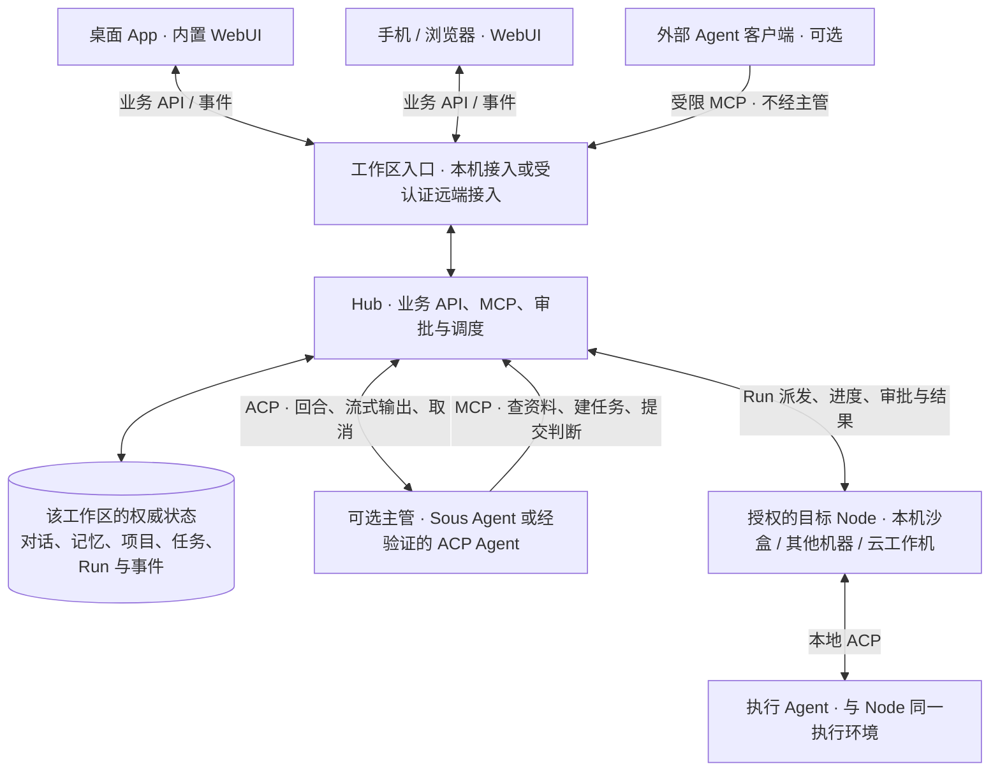
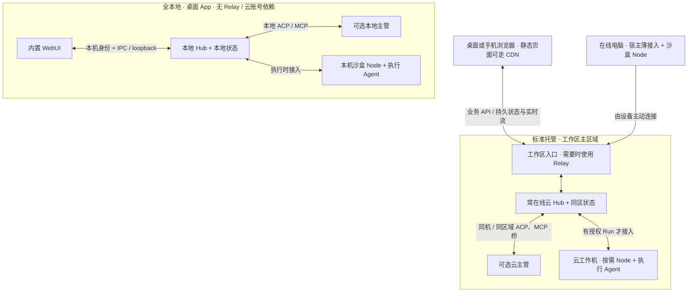
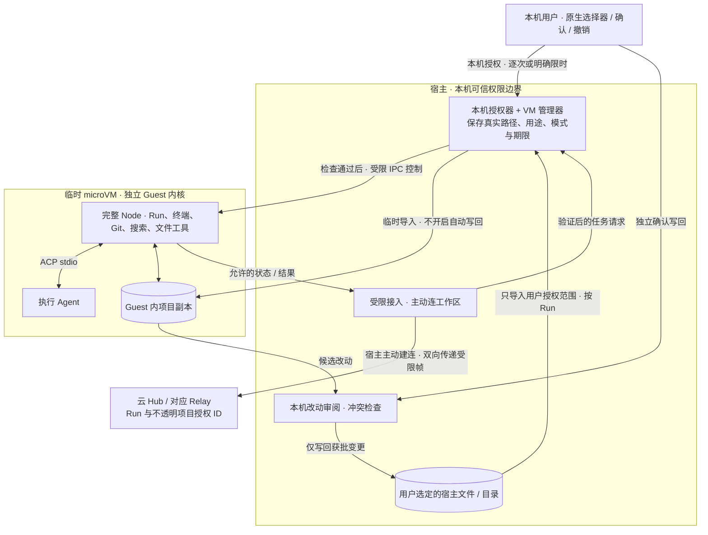
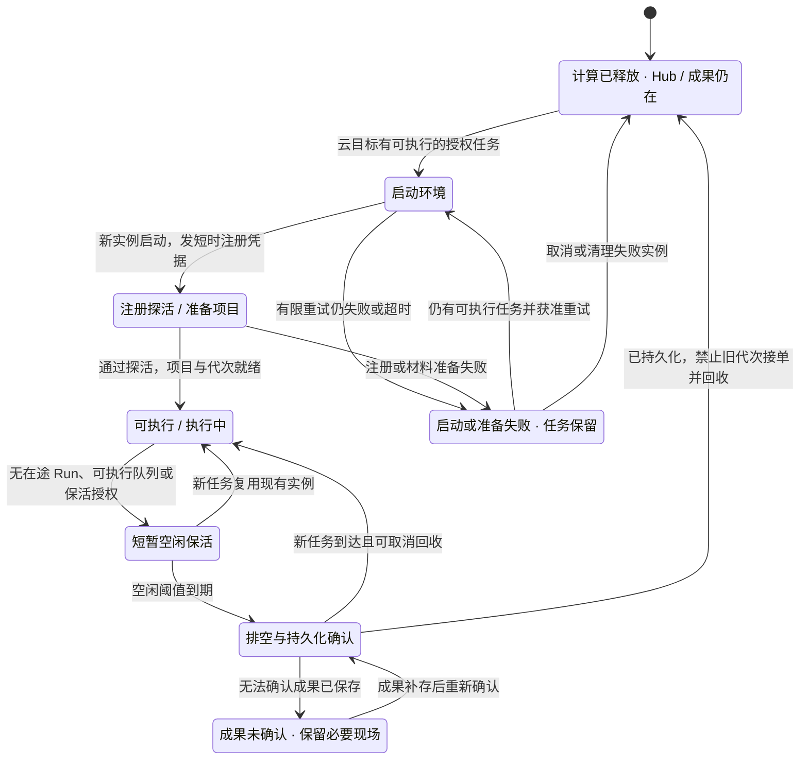
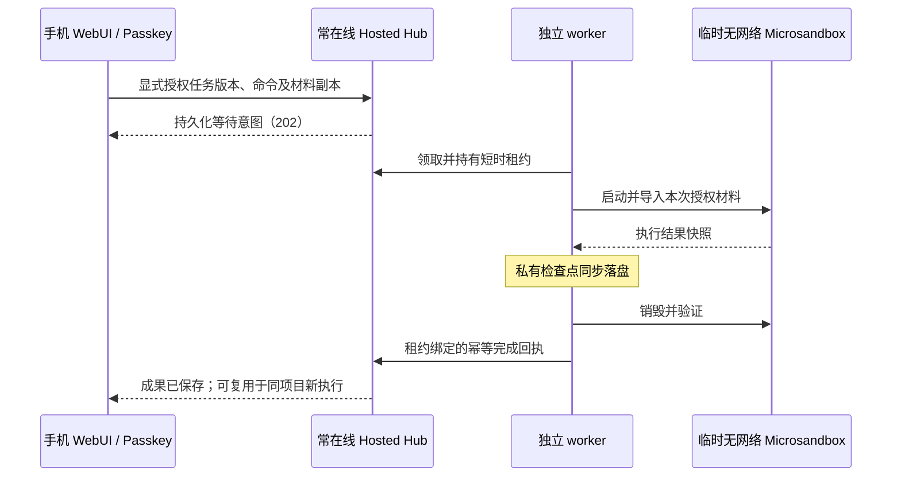
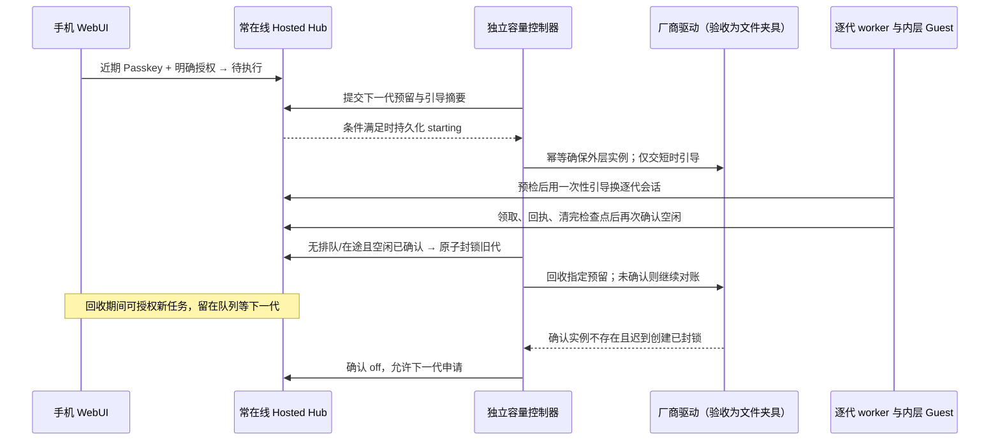

# Sous 新架构图

> 目标态，不是当前部署图。配套：[讨论结果](discussion-results.md) · [技术设计](design.md) · [实施与验收任务](tasks.md)。

## 1. 模块、协议与权威状态

- 外部 MCP、远程主管和多机连接是可选能力，不是纯本地路径的依赖。WebUI 不直连主管或 Node；主管通过 Hub 工具，不直连 Node 或 Hub 数据库。一个工作区只有一个 Hub 权威，不把同屏出现的本地工作区和云工作区混成双主。
- **App 是装配层**：同包不等于强依赖，不为每个框各起一个远程服务。Hub 与主管同机时也保持 ACP/MCP 边界；主管角色与执行 Agent 的身份和权限不共享。

## 2. 两种默认部署；混搭只替换相应端点

| 混搭 | 只替换哪条边 | 不会发生什么 |
|---|---|---|
| 本地 Hub + 云主管 / 手机 WebUI | 远程 WebUI 接到本地 Hub；主管 ACP 和受限 MCP 经认证适配器跨 WAN | 云端不会复制一个权威 Hub；家中 Hub 断线时不能接管其任务 |
| 云 Hub + 本地 Codex 等主管 | 本地连接器接到云 Hub，Agent 端仍可跑 ACP stdio；桌面和其他 Node 独立在线 | 主管掉线不会阻断 Hub 的手动派发，不静默换主管 |
| 外部 MCP + 桌面；本地 / 云工作区任选 | 外部客户端与桌面选中同一工作区时共用同一权威数据；选中不同工作区时隔离 | 不需要每次 MCP 工具调用途经 Sous Agent；不做同工作区双写、Node 互相转发或自动把离线的本地目标换成云目标 |

**热路径**：普通对话只经过入口、Hub、主管及其模型，不等待 Node 或 VM。部署靠近 Hub 的是高频工具调用和数据层，不是静态前端制品。需要现有信任/中继通道时保留语义；没必要的前端应用代理不加入实时链路。

## 3. 云 Hub 到本机 Node：运行请求不是宿主文件权限

图中的本机临时 microVM 由 **Microsandbox** 提供；此选型不限定第 4 节的云工作机。

**默认不做实时共享。** Run 结束、取消、授权到期或撤销后关闭本机授权窗口，销毁临时 VM 并清理导入副本；如果后来启用挂载，撤不掉由宿主终止 VM 和发布共享的服务。入口没有任意路径、宿主 shell 或 VM 通用管理接口。Guest 默认不通公网/宿主 LAN；仅按本机策略放行所需模型或依赖，不复用有项目内容的 VM 快照。隔离不能追回已通过授权通道发出的数据。

## 4. 云工作机：独立于聊天的启停状态机

草稿、普通聊天、前置审批、等本地 Node 都不触发 `Off → Starting`。已进入 Run 的审批等待不是空闲。无法取消排空时，新任务先留在 Hub，回收后按新代次启动。恢复的是持久成果和业务记录，不是原进程内存；启动/回收失败要对账，不盲目再执行。

## 当前已实测的托管执行路径（参考 worker）

该证据只覆盖 Apple Silicon 的离线 Guest，不包含云厂商启动或停止 Linux 宿主，也不支持云 Hub 操作个人电脑或旧 Node。

## 当前已联合验证的容量控制路径（厂商夹具）

已测的是 Hub、控制器进程、worker 和真实内层 Guest；外层厂商实例仍以夹具代替。当前版本跨过排空栅栏后不复活旧代，回收期间来的任务始终排队。不把夹具的 `absent` 当成真实账单归零。
