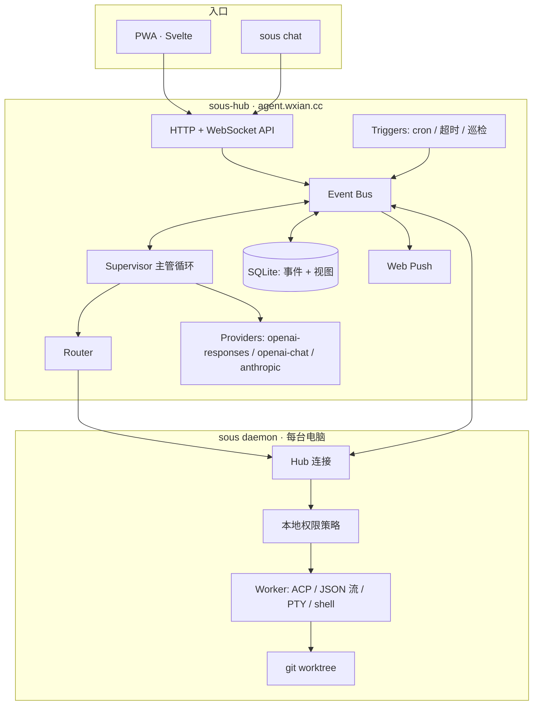

# sous MVP：设计

背景决策见 `docs/decisions/0001`～`0011`。本文写的是“怎么做”。标了「待验证」的地方，要在对应任务开工时先实测，再定稿。

遇到设计问题时，先读 `work/agent/rules/super-agent-reference.md`，再去 DeepSeek Super-agent 原型里找对应的思路。本文中标了「参考 SA-n」的地方，对应该文档“值得借鉴的思路”一节的第 n 条。

## 1. 总览



## 2. apps/core 包结构

```
apps/core/
├── cmd/
│   ├── sous-hub/        服务端入口
│   └── sous/            客户端入口：daemon / pair / status / chat / update / service
├── internal/
│   ├── event/           事件类型、事件总线、追加写入和订阅
│   ├── store/           Store 接口 + sqlite 实现（建表迁移、视图投影）
│   ├── provider/        Provider 接口 + 三种协议适配器 + 统一消息格式
│   ├── supervisor/      主管循环、上下文组装、发言策略、主管工具
│   ├── task/            任务状态机、依赖关系
│   ├── router/          路由策略
│   ├── trigger/         cron、跟进（超时、受阻、等待回复）、数据保留
│   ├── inspector/       巡检 agent：规则预筛 + 模型判断 + 暂停/终止/通知
│   ├── watchdog/        进程内存活检测
│   ├── memory/          记忆检索（目前在 store 里：两字片段子串匹配打分）
│   ├── tool/            Tool 接口、注册表、内置工具、远程 MCP 客户端
│   ├── channel/         Channel 接口；web 实现（HTTP/WebSocket）
│   ├── notify/          Notifier 接口；webpush 实现
│   ├── auth/            Passkey、会话、设备令牌、配对码
│   ├── proto/           Hub ↔ Node 协议消息（两个二进制共用）
│   ├── node/            daemon：连接、心跳、上报 agent 清单、命令分发
│   ├── worker/          Worker 接口；acp / jsonstream / pty / shell 实现
│   ├── policy/          操作分类、三档模式、底线规则
│   ├── workspace/       git worktree 的创建、清理、分支命名
│   ├── ipc/             daemon 本地 IPC（各平台都用 Unix socket），给 desktop 和 sous chat 用
│   ├── update/          检查 GitHub Releases、下载、校验、替换自身
│   └── plugin/          进程外插件宿主（stdio JSON-RPC）
└── go.mod
```

## 3. 扩展机制

**进程内**：参考 `database/sql` 的 driver 注册方式。每类模块定义一个接口和一个注册表，具体实现在 `init()` 里注册，配置文件里按 `kind` 名字启用。

```go
type Provider interface {
    Name() string
    Stream(ctx context.Context, req ChatRequest) (<-chan ChatChunk, error)
}

type Worker interface {      // 运行在 Node 上
    Kind() string            // "acp" / "jsonstream" / "pty" / "shell"
    Detect(ctx context.Context) []AgentInfo
    Start(ctx context.Context, spec RunSpec, sink RunSink) (RunHandle, error)
}

type RunHandle interface {
    Send(ctx context.Context, msg string) error   // 中途追加指令
    Cancel(ctx context.Context) error
    Wait() RunResult
}

type Channel interface {     // 入口
    Name() string
    Serve(ctx context.Context, bus event.Bus) error
}

type Notifier interface {
    Notify(ctx context.Context, n Notification) error
}

type Tool interface {        // 主管能调用的工具
    Spec() ToolSpec          // 名字、描述、JSON Schema
    Call(ctx context.Context, args json.RawMessage) (ToolResult, error)
}

type Trigger interface {
    Name() string
    Run(ctx context.Context, bus event.Bus) error
}

type Store interface { /* 追加事件、读事件流、读写视图，见第 4 节 */ }
type Memory interface {
    Put(ctx context.Context, m Item) error
    Search(ctx context.Context, q string, k int) ([]Item, error)
}
```

**进程外**：

- 工具：走 MCP（Hub 只连远程 HTTP MCP；本地 MCP 由子 agent 自己使用）。
- 子 agent：走 ACP。
- 其他扩展（新入口、新通知方式）：通过 `plugin/` 用 stdio JSON-RPC 拉起外部进程，用任何语言写都行。第一期只搭好宿主，不写外部插件。

## 4. 数据模型（Hub · SQLite）

**事件表是唯一的事实来源**，其他表都是由事件投影出来的视图，在同一个事务里更新。只有 `event` 包里的一个写入者能追加事件、更新视图；推送通知、给 Node 下发任务等外部副作用，在同一个事务里写入 `effects` 队列，提交之后再执行（参考 SA-6、SA-7）。

```sql
events(
  seq        INTEGER PRIMARY KEY,   -- 全局递增，客户端用它做断点续传
  id         TEXT UNIQUE,           -- ULID
  ts         INTEGER,
  type       TEXT,                  -- 见下表
  actor      TEXT,                  -- user / supervisor / node:<id> / inspector / system
  thread_id  TEXT, task_id TEXT, run_id TEXT,
  payload    TEXT                   -- JSON
)
threads(id, title, kind, created_at, updated_at, archived)  -- kind: main（主线，唯一）/ chat / project
messages(id, thread_id, role, content, event_seq)          -- 对话视图
tasks(id, parent_id, origin_thread_id, kind, title, detail, status, priority, project_id,
      agent_pref, node_pref, permission_mode, pr_url, created_at, updated_at)
      -- kind: code / general；permission_mode 在派发时固化为快照（参考 Mandate）
task_deps(task_id, depends_on)
runs(id, task_id, node_id, agent, workdir, branch, status, report,
     started_at, ended_at, summary, diff_path, acp_session_id)
     -- report: progress / waiting / ready / blocked / failed / dropped（沿用 SA 的汇报类型）
effects(id, kind, key, payload, attempts, last_error, due_at)  -- 副作用队列
approvals(id, run_id, task_id, action_kind, detail, status, decided_by, note, created_at, decided_at)
nodes(id, name, os, arch, version, agents_json, last_seen, revoked)
projects(id, name, repo_url, default_mode)
project_nodes(project_id, node_id, path, priority)          -- 路由优先级
memories(id, kind, content, source_event, created_at, updated_at)  -- + FTS5 虚表
schedules(id, cron, prompt, thread_id, enabled, last_run)
usage(id, ts, provider, model, role, input_tokens, output_tokens, cached_tokens, run_id, task_id)
push_subscriptions(id, endpoint, keys_json, created_at)
credentials(id, public_key, sign_count, created_at)        -- Passkey
settings(key, value)
```

**事件类型**（第一期）：

| 分组 | 类型 |
|---|---|
| 对话 | `message.user` `message.assistant` `thread.created`（流式片段 `message.assistant.delta` 只实时推送给在线客户端，**不写入事件表**） |
| 任务 | `task.created` `task.updated` `task.status` `task.reviewed` |
| 执行 | `run.queued` `run.started` `run.update`（进度、工具调用、输出） `run.ended` |
| 审批 | `approval.requested` `approval.decided` |
| 机器 | `node.online` `node.offline` `node.inventory` |
| 主动 | `trigger.fired` `inspector.finding` |
| 记忆 | `memory.put` `memory.deleted` |
| 系统 | `usage.recorded` `notify.sent` |

`run.update` 的数据量最大。原始输出保存到 Hub 本地的 `runs/<run_id>.log` 文件，Run 结束时上传的 diff 保存为 `runs/<run_id>.diff`，事件里只放摘要和偏移量，避免 SQLite 膨胀。

**数据保留**：从一开始就做（原型没有做，表会无限增长）。已关闭超过 N 天（默认 90 天）的任务，归档它的 Run 日志和 diff 文件；事件表本身不删除。

## 5. 主管循环

- 每个线程一个串行处理队列（goroutine 加 channel）。同一线程里的事件按顺序处理，不同线程之间并行。一轮处理期间新到的事件，合并进下一批一起处理（参考 SA-8）。
- **事件归属**：用户消息归它所在的线程；任务和 Run 的事件归任务的 `origin_thread_id`；定时触发、巡检发现的问题、机器上下线等系统事件归**主线**。
- **后续消息**：如果线程里有正在执行的任务，用户的后续消息会同时作为上下文转发给那个 Run（通过 `run_message`）；由主管判断这条消息是不是要开一个新任务（参考 SA-10）。
- 收到事件后，先**组装上下文**：系统提示 + 当前线程最近的消息（更早的只放摘要）+ 相关任务的状态摘要 + 检索到的记忆 + 在线机器和 agent 清单。
- **发言策略**由主管 LLM 在每轮输出时决定，第一期有三种：`reply`（回复用户）、`act`（只调用工具、不说话）、`silent`（只记录）。会议旁听模式就是把默认策略固定为 `silent`。默认遵循“最少注意力”原则：接到任务确认一次，执行期间保持安静；只在有结果、需要决定、做不下去时发言；一次只问一个具体问题（参考 SA-1～SA-4）。
- **主管的工具**：

| 工具 | 作用 |
|---|---|
| `task_create` / `task_update` / `task_cancel` | 维护任务 |
| `dispatch` | 把任务交给 Router，可以指定机器和 agent |
| `run_message` / `run_cancel` | 给正在执行的 Run 追加指令或终止它 |
| `request_approval` | 主管自己需要用户拍板时用 |
| `notify` | 主动推送通知 |
| `memory_put` / `memory_search` | 记忆 |
| `schedule_create` / `schedule_delete` | 定时任务 |
| `web_search` / `web_fetch` | 联网（第一期先接一个搜索服务，「待验证」选哪家） |
| `mcp:*` | 远程 MCP 工具 |

- **维护任务**：第一期由主管在对话中直接调用 `task_create` / `task_update`，不单独设置 extractor（见 docs/decisions/0011）。
- **验收**：收到 `run.ended`（成功）后，reviewer 角色读取任务描述、Run 摘要和**完整 diff**（超过阈值时截断，并附上完整的文件列表和 diff 统计），输出通过或打回（附原因）。需要深度审查时，主管可以另派一个子 agent 在 Node 上做代码审查。
- **交付**（代码任务，见 docs/decisions/0009）：验收通过后，主管下发“push 分支并创建 PR”的指令（类别 git-remote，按权限模式审批）。sous 永远不合并到主分支。PR 有冲突时，主管派一个新的 Run 去 rebase。验收不通过时，创建新的 Run，带上打回的原因。

## 6. 路由

```
dispatch(task, node?, agent?)
  ├─ 指定了 node → 直接用；不在线就排队并通知
  ├─ 否则取 task.project 的 project_nodes，按 priority 排序
  │     → 选第一台“在线 + 装了所需 agent 且已登录 + 并发未满”的机器
  └─ 都不满足 → run.queued，等 node.online 事件再重试；同时通知用户
agent 选择：task.agent_pref > 项目默认 > 全局默认（可配置）
```

每台 Node 的并发上限可以配置，默认 2。

## 7. Node 执行流程

1. `sous daemon` 启动后，用设备令牌连接 `wss://agent.wxian.cc/node`，上报 `node.inventory`（系统信息和探测到的 agent）。
2. 收到 `run.start` 后：
   1. 准备工作目录：
      - 代码任务：从项目仓库创建 worktree，统一放在 `~/.sous/worktrees/<项目>/<短 id>`（不放在项目目录里，避免产生未跟踪文件，也避免 Windows 路径过长）。分支名 `sous/<task-slug>-<短 id>`。同一个任务的多次 Run 复用同一个 worktree 和分支。
      - 一般任务：在 `~/.sous/scratch/<短 id>` 里执行。
   2. 用对应的 Worker 启动 agent，在 ACP 会话里发送任务描述。**在默认和自动审批模式下，agent 以“每个操作都询问”的方式启动**（各家 agent 的具体参数「待验证」），保证所有操作都经过 sous 的权限判断；只有在完全开放模式下，才允许 agent 按它自己的规则放行。
   3. ACP 的 `session/update` → `run.update`；ACP 的 `session/request_permission` → 先经本地 policy 分类：
      - 落在底线规则里：直接拒绝。
      - 当前模式下不需要审批：直接放行。
      - 需要审批：上报 `approval.requested`，等 Hub 回传 `approval.decided`。
3. Run 结束后，上报 `run.ended`，附带摘要、diff 统计、分支名，并上传完整 diff（相对基线分支）。worktree 先保留，任务关闭后再清理。
4. 断线时，Node 在本地缓存要上报的事件，重连后按序号补发；Hub 端按事件 id 去重。
5. agent 在前台执行的命令超过一定时间（比如 5 秒），尽量转到后台，让 agent 能及时收到追加的指令（参考 SA-13；取决于各家 agent 是否支持，「待验证」）。
6. 临时性故障（模型服务或网络返回 408、429、5xx，连接被拒绝、被重置或超时）自动重试 3 次，间隔逐渐拉长；其他失败直接汇报，等主管或用户处理（参考 SA-14）。

**五个 agent 的实测结果**（2026-11-03，macOS；Windows 和 Linux 尚未实测）：

| agent | 启动方式（`internal/agents`） | 握手 | 登录检测 | 备注 |
|---|---|---|---|---|
| Claude Code | `npx -y @agentclientprotocol/claude-agent-acp@0.100.0` | ✅ session/new 返回 modes：`default`（每步询问）、`acceptEdits`、`plan`、`auto`、`bypassPermissions` | `claude auth status` 的 JSON `loggedIn` | 命令行版要单独登录，桌面 App 的登录不通用 |
| Codex | `npx -y @agentclientprotocol/codex-acp@2.5.0` | ✅ | `codex login status`（"Logged in" / "Not logged in"） | |
| Cursor | `cursor-agent acp` | ✅ 需要先调用 `authenticate`（methodId `cursor_login`）；`initialize` 的 `clientInfo` 必须带 `version` | `cursor-agent status` | 模式是 `agent` / `plan` / `ask`，其中 `ask` 是只读问答，不能当“每步询问”用，sous 固定用 `agent`（它在执行 shell 命令前会请求权限）。免费账号的默认模型不可用，要在 `node.json` 里覆盖成 `["cursor-agent", "--model", "auto", "acp"]`，否则只报 `WritableIterable is closed`。认证要读钥匙串，daemon 必须以用户身份在沙盒外运行（2026-11-04 实测跑通一般任务） |
| OpenCode | `opencode acp`，并通过 `OPENCODE_CONFIG_CONTENT` 把 edit、bash、webfetch、external_directory 设成 `ask` | ✅ 返回 `configOptions`（可选模型），没有 `modes` | 无法预先判断 | 免费模型有额度限制（2026-11-04 实测全部用完）。审批选项 id 是 `once` / `always` / `reject`。模型在 opencode.json 或 `OPENCODE_CONFIG=<文件>` 里选 |
| Kiro | `kiro-cli acp`（未验证） | — | — | 本机只装了 Kiro IDE，没有 Kiro CLI |

- 实测必须在沙盒外进行：agent 的登录凭据在 macOS 钥匙串里，受限的沙盒环境读不到，会误报“未登录”。真实的 daemon 以用户身份运行，没有这个问题。
- 五个 agent 都支持 ACP，所以第一期**没有实现** jsonstream / PTY / shell 退路；`Worker` 的位置由 `internal/acp` + `internal/node/run.go` 承担。需要时再加。
- Go 版 ACP 客户端是自己实现的（`internal/acp`，stdio 上按行分隔的 JSON-RPC 2.0），不声明 fs 和 terminal 能力，agent 用自己的工具在 worktree 里干活。
- 测试用的假 agent 在 `internal/acp/acptest`：在测试二进制里运行，覆盖写文件、认证、未登录、慢任务、崩溃几种行为。
- **权限请求先过本地策略**（M3，`internal/policy`）：按第 8 节分类和查表，自动放行或拒绝的操作作为 `run.update`（`kind: permission`）写进事件日志；需要审批的才发 `approval.request`。各家 agent 的“每步询问”模式（`default`、`ask`、`manual`）在 `default` 和 `auto` 下启用；`open` 下切到 agent 的放行模式。
- OpenCode 没有可切换的 session mode，默认直接放行改文件和 shell 命令，不会发 `session/request_permission`，等于绕过 sous 的策略（2026-11-04 用真实 opencode 发现）。现在启动时用内联配置让它每步询问；`open` 模式下它照样询问，由 sous 的策略放行，底线规则仍然生效。
- **设备令牌目前存在 `~/.sous/node.json`（权限 0600）**，还没有放进系统钥匙串。

**任务的执行（M3 实现）**：
- 引擎在 `internal/task`，状态变化都是 `task.status` 事件。Run 结束时，投影在同一个事务里给 effects 队列加一条 `task.advance`，由引擎决定下一步：验收（reviewer 读完整 diff，超过 6 万字截断并附文件列表）→ 不通过就带着原因再派一个 work Run（同一个 worktree 和分支；从上次手动派发算起最多 3 次，之后转为受阻）→ 通过后，代码任务排一个 deliver Run，一般任务直接完成。
- deliver Run 报告 PR 有冲突时，引擎派 rebase Run（交给写代码的那个 agent，最多 2 次），之后再交付一次（`--force-with-lease`）。
- 任务排队（`queued`）时，`next` 记着下一个 Run 的用途（work / rebase / deliver），`status_reason` 写着在等什么。机器上线、上报清单、有 Run 结束、依赖的任务完成时，以及每分钟一次，引擎重试所有排队的任务；第一次开始等机器时推送通知。
- 后续的 Run 固定派到持有分支的那台机器（router 的 `Sticky`）。任务完成或取消后，向跑过它的机器发 `workspace.remove` 删除 worktree（离线就保留）。
- 汇报：任务完成、失败、受阻时，引擎在发起它的线程里发一条 `kind: report` 的消息（主线发起的就在主线），`task.status` 事件负责推送。
- 主管的任务工具：`task_create`、`task_update`、`task_cancel`、`task_dispatch`、`task_list`、`run_message`、`run_cancel`（M2 的 `run_agent` 已移除）。线程里有执行中的任务时，提示里会写出来，并要求用户的补充用 `run_message` 转给 agent；用 `task_update` 改执行中任务的说明时，新说明也会自动转给 agent。
- effects 并发执行（同一条不会同时跑两次），所以验收和审批的模型调用不会堵住推送。

## 8. 权限分类

Node 把每个操作归为以下一类，再查表决定处理方式：

| 类别 | 例子 | 默认 | 自动审批 | 完全开放 |
|---|---|---|---|---|
| read | 读文件、git status/diff/log | 放行 | 放行 | 放行 |
| edit-worktree | 在 worktree 里写文件 | 放行 | 放行 | 放行 |
| exec-safe | 测试、构建、lint（白名单命令） | 放行 | 放行 | 放行 |
| exec-other | 其他命令 | 审批 | AI 审批 | 放行 |
| install | 安装依赖 | 审批 | AI 审批 | 放行 |
| outside-worktree | worktree 之外的读写或执行 | 审批 | AI 审批 | 放行 |
| delete | 删除文件 | 审批 | AI 审批 | 放行 |
| git-remote | push、创建 PR | 审批 | AI 审批 | 放行 |
| irreversible | force push、删除分支、发布 | 审批 | 交给用户 | 放行 |
| floor | 底线规则命中 | 拒绝 | 拒绝 | 拒绝 |

“AI 审批”由 Hub 上的审批 agent（approver 角色）完成：信心不足或者判定有风险时，再转给用户（`approval.escalated`，带上理由）。审批模型连续调用失败 3 次也转给用户。

实现（`internal/policy`，Node 本地执行）：
- 按 ACP 的 tool kind 分类：read/search/think/fetch → read，edit/move → edit-worktree，delete → delete；路径落在工作目录之外的一律 outside-worktree。
- execute 从 `rawInput` 里取命令（`command` 可以是字符串或 argv），按 `&&`、`;`、`|` 拆开，取最危险的一段。白名单按工具和子命令判断（`go test`、`npm run build`、`cargo check`……），`npm ci` 和不带包名的 `npm install` 算 exec-safe；`git push --force`、删除远端分支、`npm publish`、`sudo` 算 irreversible。
- 底线规则是正则，默认包括删除根目录或 home、格式化或覆写磁盘、fork 炸弹、关机重启、`curl … | sh`。`node.json` 的 `policy.floor_disabled` 可以关掉，`floor` 替换、`extra_floor` 追加。

**这张表是安全网，不是安全隔离**（见 docs/decisions/0010）：
- 它只能拦住 agent 通过 ACP 请求权限的操作；所以除了完全开放模式，其他模式都要求 agent 以“每个操作都询问”的方式启动。
- 底线规则按命令文本匹配，换个写法（比如写成脚本再执行）就能绕过。
- 真正的执行隔离要靠操作系统级沙盒（macOS 的 seatbelt、Linux 的 bubblewrap 或 landlock、Codex 自带的沙盒），放到第二期。
- 来自外部的内容（网页、文件、子 agent 的输出）只是数据，不能改变权限（参考 SA-19）。

## 9. 主动性与看门狗

- **Trigger**：`cron`（schedules 表）、`timeout`（Run 或审批等待超时）、`followup`（任务受阻、等待用户回复超过 N 小时）、`inspector`。
- **巡检 agent**：每 10 分钟取一次快照，包括：运行中的 Run（耗时、最近 N 次工具调用、最近一次进展的时间）、近一段时间的 token 用量。规则先过一遍（比如同一个工具加同样参数连续出现超过 5 次），疑似的再交给 inspector 模型判断，输出 `inspector.finding`，内容包括严重程度和建议的动作（暂停、终止或通知）。
- **进程看门狗**：
  - 进程崩溃后的重启，交给系统服务管理器（systemd 的 `Restart=always`、launchd 的 `KeepAlive`、Windows 服务的故障恢复），由 `kardianos/service` 统一配置。
  - 进程内另有一个存活检测的 goroutine：关键循环卡住超过阈值时，主动退出进程，让服务管理器拉起。
  - 恢复：Hub 启动时回放未结束的 Run 和审批；Node 重连后对账。对于没能恢复的 Run，如果 agent 支持 ACP 的 `session/load` 就续上，否则标记为 `interrupted`，由主管决定是否重试。
  - 续跑或重试时，新的 Run 会带上一段**恢复说明**：要求 agent 先检查工作目录、git 历史和远端状态，确认之前做到了哪一步，再决定要不要重复任何对外操作（比如 push、创建 PR）。按任务从旧到新的顺序恢复（参考 SA-15）。
  - 记录哪些追加消息已经送进 agent 的会话，重试时只补发没被读取的部分（参考 SA-16）。

**M4 的实现**：
- **定时任务**（`internal/trigger`）：`schedules` 表由 `schedule.put` / `schedule.deleted` 投影；cron 是自己写的 5 字段解析（`*`、范围、列表、步长、`@daily` 等，日和周都限定时按标准 cron 取“或”）。每 30 秒检查一次，以 `max(上次触发, 最后修改)` 为起点算下次时间，所以 Hub 停机期间错过的只补触发一次，改时间也不会立刻触发。时区按定时任务自己的 `tz`，缺省取免打扰设置里记下的设备时区。
- **触发即消息**：定时任务和跟进都追加 `trigger.fired` 事件，投影成线程里一条 `role: user`、`kind: trigger` 的消息，主管照常处理一轮（`unanswered` 把它当成用户消息）。提示词里说明了【定时任务…】和【跟进】开头的消息是什么、怎么处理；主管可以 `stay_silent`。触发时间记在事件里（`at`），所以用假时钟的测试和真实时间一致。
- **跟进**：每 5 分钟检查：受阻或失败且没被用户关掉的任务超过 4 小时、执行超过 2 小时的 Run、等用户审批超过 2 小时的操作、主管提的问题（最后一条助手消息以问号结尾）8 小时没有回复。每种情况按 key（`task:<id>:<状态时间>`、`run:<id>:timeout`、`approval:<id>`、`question:<消息 id>`）只跟进一次，key 记在 `trigger_state` 表。
- **巡检**（`internal/inspector`）：每 10 分钟取一次快照。规则：同一个工具加同样的标题连续出现超过 5 次（repeat，默认暂停）；30 分钟没有任何事件、也没在等审批（stalled，通知）；执行超过 3 小时（long，通知）；一个周期内 token 超过 200 万（tokens，通知）。可疑的交给 inspector 模型判断（输出严重程度、动作、给用户看的原因），模型可以判定没问题（`none`，记下来不再问）；模型调用失败就按规则的默认动作。同一个 Run 的同一条规则只报一次，Run 被继续之后重新计。结果写 `inspector.finding`（推送 `inspector` 类通知），并在主线留一条 `kind: inspector` 的说明。
- **暂停**：ACP 没有暂停，sous 用“取消当前这一轮 + 不结束 Run”实现：Hub 记 `run.paused` 并发 `run.pause`，Node 发 `session/cancel`、取消未答复的权限请求（Hub 侧这些审批随之过期），然后在两轮之间等待。`run.resume` 或一条追加指令让它继续。任务的状态保持进行中，原因写成“已暂停：…”，首页“需要你处理”里会列出来。
- **进程看门狗**（`internal/watchdog`）：Hub 的副作用队列、任务引擎、定时任务、巡检这几个循环要定期心跳，数据库写锁每 15 秒探测一次；超过时限（2～5 分钟）就以退出码 3 退出，交给服务管理器重启。daemon 探测自己的锁。`sous-hub` 和 `sous daemon` 打开看门狗，测试不打开。
- **daemon 的恢复**：发件箱持久化（`outbox.jsonl`）；每个 Run 的状态（spec、会话 id、agent 能否 `session/load`、已送达的追加消息、是否暂停）存在 `runs/<id>.json`。daemon 正常退出时不报 Run 结束；重启后按 `welcome.resume_runs` 对账：能加载会话的就加载并接着做（回放的历史不再上报，先发一段重启说明），否则报 `interrupted`。ACP 的通知改为按顺序同步处理，否则加载会话时回放的消息可能晚于加载结果到达。
- **中断后的重试**：任务引擎收到 `interrupted`，在同一次派发内自动再开一个 Run（最多 1 次），带上恢复说明：先检查工作目录、git 历史和远端状态，不要重复对外操作，并附上上一个 Run 没送达的追加指令；同时在任务的线程里发一条带推送的汇报。再中断就按失败处理。交付 Run 中断后也会重新交付一次（push 和创建 PR 本身可以重复）。
- **追加消息的送达**：`run.message` 先作为事件存下（机器离线也能发），Node 在把它放进 `session/prompt` 之前上报 `run.delivered`。重连时 Hub 重发没送达的，Node 按消息 id 去重。
- **数据保留**：每天一次，把关闭超过 90 天的任务的 Run 日志和 diff 压缩成 `runs/archive/<id>.{log,diff}.gz`，记 `run.archived`；读日志和 diff 的接口会自动从归档里读。
- **用量**：`/usage` 增加按天（按用户时区）的统计，界面有“用量”页。只统计 sous 自己的模型调用；编程 agent 不上报 token。
- **临时故障重试**：Node 启动 agent 或打开会话时，错误文本像网络故障或 408/429/5xx 的，间隔 2、5 秒再试两次。
- **`sous chat`**：daemon 在 `~/.sous/daemon.sock` 上提供 IPC（见 `docs/api/core-daemon-ipc.md`），用设备令牌调用 Hub 的 `/api/v1/device/` 接口（只有线程、消息、事件流和审批）。终端界面是逐行的：历史、流式回复、任务和审批提示，`/approve` 审批；daemon 重启时自动重连。
- **更新**（`internal/update`）：Hub 缓存 GitHub Releases 的最新版本（1 小时）供界面显示；点“更新”后 Hub 发 `node.update`，Node 下载 `sous_<版本>_<系统>_<架构>`，按 `checksums.txt` 校验，替换自己（Windows 上先把正在运行的程序改名为 `.old`），上报结果，然后重启：在服务管理器下以退出码 3 退出等它拉起，在终端里用 exec 换成新程序。Run 在重启后恢复。Hub 自己不自动更新。
- **发布**：`apps/core/.goreleaser.yaml` 和 `.github/workflows/release.yml`：打 `v*` tag 时跑测试、构建 PWA，发布 `sous`（三个系统 × amd64/arm64）和 `sous-hub`（Linux，压缩包里带 `web/`、配置模板和部署文件），版本号通过 `-ldflags` 写进 `internal/version`。

## 10. 模型层

- 内部使用统一的格式：`Message{Role, Parts[]}`，Part 包括文本、工具调用、工具结果、思考内容；工具定义统一用 JSON Schema。
- 三个适配器各自负责和统一格式互相转换，包括流式输出和工具调用。
- 每次调用后写入 `usage` 事件。

```yaml
# hub.yaml（示例，不含密钥）
providers:
  - name: deepseek
    kind: openai-chat
    base_url: https://api.deepseek.com
    api_key_env: DEEPSEEK_API_KEY
roles:
  supervisor: deepseek/<model>
  reviewer:   deepseek/<model>
  approver:   deepseek/<model>
  inspector:  deepseek/<model>
```

**提示词**按层组装：共享指令 → 角色 → 用户自定义部分 → 工作说明 → 环境 → 当前权限模式和规则。经常变化的部分放在最后，这样前面的部分能命中缓存（参考 SA-17）。用户覆盖默认提示词时，记录它基于哪个版本（参考 SA-18）。

具体模型名开工时再定（「待验证」：DeepSeek 当前的模型对工具调用和长上下文的支持情况）。

## 11. 认证与安全

- **用户登录**：只用 Passkey（WebAuthn）。第一次启动时，Hub 在日志里打印一个一次性注册链接；注册完第一个 Passkey 之后就关闭注册入口。之后在已登录的设备上可以添加更多 Passkey。
- **找回**：在服务器上执行 `sous-hub admin passkey-reset`，打印一个新的一次性注册链接（能登录服务器本身就证明是用户本人）。可以加 `--revoke-all` 同时吊销所有旧的 Passkey。
- **Web Push**：VAPID 密钥对在 Hub 首次启动时自动生成，保存在数据目录的 `vapid.json`（0600），不写进配置文件。消息按 RFC 8291（aes128gcm）加密，自己实现，没有第三方依赖（`internal/notify`）。推送是 effects 队列里的 `push` 副作用：按类型开关和免打扰过滤（免打扰期间只推审批），推送服务返回 404/410 时删除订阅，每次发送记一条 `notify.sent`。
- **备份**：`work/infra/` 里提供备份脚本，用 `VACUUM INTO` 生成一致的快照，并同时打包 `runs/` 目录。
- **会话**：HttpOnly Cookie 加 CSRF 防护；WebSocket 连接在握手时校验会话。
- **Node 配对**：在界面上生成一个 6 位配对码，10 分钟内有效；`sous pair <code>` 换取设备令牌，令牌保存在系统的密钥存储里（macOS 钥匙串、Windows 凭据管理器、Linux Secret Service；没有的话就存成权限为 0600 的文件）。设备可以在界面上吊销。
- **TLS**：由用户的反向代理负责，Hub 自己只监听本地地址。
- **密钥**：只从环境变量读取，配置文件里只写环境变量名。

## 12. 客户端接口（概要，详细见 docs/api）

- `core-hub-http.md`：REST 接口（线程、任务、审批、机器、项目、设置、记忆、用量、推送订阅、更新信息），加一个 WebSocket `/ws`。客户端带上 `since=<seq>` 订阅事件流，断线重连后从断点补齐。
- `core-hub-node.md`：WebSocket `/node`，JSON 帧：`hello` `inventory` `run.start` `run.message` `run.cancel` `run.update` `run.ended` `approval.request` `approval.decide` `ping/pong` `ack`。
- `core-daemon-ipc.md`：本地 IPC 接口，提供状态、更新、日志，以及一个转发给 Hub 的聊天通道（这样 `sous chat` 和 desktop 不需要另外登录）。

## 13. PWA（apps/web）

- **首页只显示需要你处理的事**：待审批、等你回答的问题、待你评审或合并的 PR、受阻或失败的任务；一切正常时首页就是空的，直接显示主线对话（参考 SA-9）。
- Svelte，第一期页面：对话（线程列表 + 消息流 + 内嵌的 Run 卡片）、任务（看板和列表两种视图）、审批（待处理队列）、机器与项目（包括路由优先级）、设置（权限模式、模型、通知、免打扰、记忆、用量、更新）。
- Service Worker：缓存静态资源加 Web Push；iOS 需要先“添加到主屏幕”才能收到推送。
- 实时数据全部来自 `/ws` 事件流，界面状态由事件投影得到，和 Hub 用同一种思路。

## 14. 跨平台注意事项

| 事项 | 做法 |
|---|---|
| SQLite 驱动 | `modernc.org/sqlite`（纯 Go，不需要 CGO，交叉编译方便） |
| 系统服务 | `kardianos/service` |
| 伪终端 | 选一个同时支持 Unix PTY 和 Windows ConPTY 的库（「待验证」） |
| 执行命令 | Windows 用 PowerShell，其他平台用 sh；命令白名单分平台写 |
| 本地 IPC | 各平台都用 Unix socket（Windows 10 起支持），不用命名管道 |
| 路径 | 一律用 `filepath`；worktree 路径不能超过 Windows 的长度限制 |

## 15. 构建与发布

- `apps/core` 用 goreleaser：`sous-hub` 只出 linux/amd64 和 linux/arm64；`sous` 出 windows、darwin、linux 的 amd64 和 arm64。
- 在 GitHub Actions 里，push 和 PR 触发 `wok test --all`，打 tag 触发 `wok build --all` 并用 goreleaser 发布到 Releases。根目录需要新增 `.github/`，用户已同意，加的时候同步更新 `.gitignore` 的白名单。
- 部署 Hub 用的 docker compose 和 systemd 单元文件放在 `work/infra/`。

## 16. 风险与待验证

1. 五个 agent 的 ACP 支持程度，以及在 Windows 上的可用性。
2. DeepSeek 模型在长时间多步工具调用下的稳定性；如果不稳，主管角色可能需要换模型。
3. iOS 上 Web Push 的送达率。
4. 选哪个联网搜索服务（要考虑服务器所在地区）。
5. worktree 的磁盘清理策略（任务关闭多久后删除）。
6. 每个 agent 以“每个操作都询问”的方式启动时用什么参数，以及能否把长命令转到后台。

## 17. 可借鉴、但第一期没有采纳的思路

- **主动工作的接单模式 off / observe / auto**（参考 SA-11）：主动发现的工作，在 observe 模式下只记录“本来会做什么”，用户看过之后再切到 auto。适合用在第二期的“主动找活”上。
- **规则变化时，把变化作为输入送给受影响的任务，而不是取消它们**（参考 SA-12）：权限模式在派发时已经固化成快照，第一期不处理中途修改。
